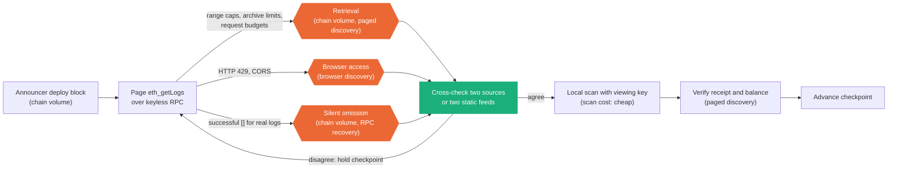

# Methods

[Overview](README.md) · [Pipeline](#discovery-pipeline) · [Hosts](#hosts-and-software) · [Live RPC](#live-rpc) · [Browser runs](#browser-runs) · [Names in recorded data](#names-in-recorded-data) · [Commands](#commands) · [Layout](#repository-layout)

## Test keys

**All keys and addresses in this repository, its fixtures and manifests are public, deterministic test material. Never fund them.**

## Discovery pipeline

Each experiment measures one stage. Orange stages failed in the recorded runs; green is the fix.



Experiments ran in this order, each reusing data or code from the earlier ones: [scan cost](docs/scan-cost.md), [paged discovery](docs/paged-discovery.md), [chain volume](docs/chain-volume.md), [browser discovery](docs/browser-discovery.md), [RPC recovery](docs/rpc-recovery.md), [shared feed](docs/shared-feed.md).

## Hosts and software

| Label in data | Hardware and OS | Pinning | Used for |
| --- | --- | --- | --- |
| `bazzite` | Desktop, Intel i7-13700K, 32 GB RAM, Bazzite 45 | Wallet on P-core threads 0,2,4,6; paged-discovery chain server on 8,10 | Scan-cost controls and profiles, all later experiments |
| `turing-node-1..3` | Turing Pi RK1 modules (Rockchip RK3588, Cortex-A76 cores 4–7), 8 GB (node 1) / 16 GB (nodes 2–3); kernels 5.10.160-rockchip (node 1), 6.1.0-1012-rockchip (node 2), 6.1.0-1025-rockchip (node 3) | `taskset -c 4-7`; paged-discovery wallet on 4–6, server on 7 | Scan cost (node 1), paged discovery, shared feed |
| Apple M1 | MacBook, Apple M1, 8 GiB RAM | none | Scan-cost initial sweep and retained-set control |

- Bun 1.4.4 (`packageManager`) and ScopeLift's [`@scopelift/stealth-address-sdk`](https://github.com/ScopeLift/stealth-address-sdk) 1.0.0-beta.5, unmodified, npm `gitHead` [`88bcc27c`](https://github.com/ScopeLift/stealth-address-sdk/tree/88bcc27c3b6163080ee18f330dfd6336dc8bd2e2). Other Bun versions run but count as a different environment.
- Browser runs: Chromium 150.0.7871.250 in Orca Electron 43.8.10 on `bazzite`.

## Live RPC

Live runs are read-only and keyless, from a residential IP in Europe. Request starts are paced per provider: ≤4/s per host (chain volume), ≥270 ms apart (RPC recovery), ≥275 ms apart (browser-discovery reference, shared feed).

## Browser runs

From the Orca worktree, start the experiment's server (port in its doc), then create an isolated profile and a tab; each command prints the next one's ID.

```sh
ORCA_CLI="${ORCA_CLI_COMMAND:-orca-ide}"
"$ORCA_CLI" tab profile create --label 'LABEL' --scope isolated --json
"$ORCA_CLI" tab create --url http://127.0.0.1:PORT/ --worktree current --profile PROFILE_ID --headless --json
```

Pass `"$ORCA_CLI"` and the page ID to the runner, with a fresh output directory. Chromium fetches public RPCs directly, with normal CORS and no credentials; the local server serves the harness and fixture and receives samples. Samples share one profile, so connection and preflight caches can persist and affect timing.

## Names in recorded data

The experiments were first numbered as phases. A few `phaseN` strings remain because recorded fixtures, seeds or evidence depend on them.

| String | Experiment | Where | Why it stays |
| --- | --- | --- | --- |
| `phase2-repeat-v1` | Paged discovery | Default `--seed` of `sweep.ts` and `scripts/paged-discovery.sh` | Prefix of the recorded shuffle seeds in `repeat/<host>/run.json`, which reproduce each `plan.json` order |
| `phase2-wallet`, `phase2-paged-discovery`, `phase2-mainnet-fetch-only` | Paged discovery | `kind` of wallet results, sweep runs and the mainnet probe | Recorded `samples.jsonl` and `run.json` carry these kinds |
| `phase2-test`, `phase2-test-zero` | Paged discovery | Seeds in `test/paged-discovery.test.ts` | Test fixtures only |
| `erc5564-scan-benchmark/phase3 (…)` | Chain volume | User-Agent in `src/chain-volume/http.ts` | Unchanged from the recorded run, so providers saw the same client |
| `phase4:base:browser:v1` | Browser discovery | Synthetic fixture seed in `src/browser-discovery/serve.ts` | Reproduces the two recorded matches and decoys |
| `phase4-checkpoint`, `phase5:<name>` | Browser discovery, RPC recovery | localStorage keys during the recorded runs (not stored in `data/`) | Renamed: the code now uses `browser-discovery-checkpoint` and `rpc-recovery:<name>`, which does not change any result |
| `phase6:base:v1` | Shared feed | Synthetic fixture seed in `src/shared-feed/run.ts` and `tune.ts` | Reproduces the recorded synthetic matches |

Recorded JSON may also name old `phaseN` paths.

## Synthetic fixtures

Scan cost and paged discovery use seeded synthetic announcements; nothing is transferred.

- `zero` targets a decoy throughout. `sparse` targets the recipient at indices divisible by `matchEvery` (default 1000).
- Ephemeral keys come from domain-separated SHA256 with rejection sampling. Logs are ABI-encoded at 128 announcements per block, one per transaction.
- Verification checks ordered `(blockHash, transactionHash, logIndex)` with multiplicity against the sender schedule, so a dropped SDK rejection cannot pass as a missing match.
- Before timing, the loader validates schema, points, decoding, identities, order, row count, SHA256 and byte counts. It reads view-tag hit counts from the manifest so it does not warm ECDH.
- The default seed `erc5564-scan-v1` gives byte-identical `announcements.jsonl`. Digests are pinned in [`data/scan-cost/*/fixtures/*/manifest.json`](data/scan-cost/) and `src/paged-discovery/prepare-fixtures.ts`, which rejects a fixture whose bytes differ.

Offline tests use the real implementations.

## Scan cost

### Measurement boundary

Each engine, mode and repetition runs in a fresh Bun process, in fixed order: load and validate, prepare expected identities, optional `--warmup`, then one timed scan and identity verification, with GC and a memory snapshot before each stage.

`scanMs` includes scan allocation and automatic GC. Imports, ABI decoding, key validation and recipient derivation run before it.

| Engine or mode | What it does |
| --- | --- |
| `sdk` | Unmodified `getAnnouncementsForUser`, no sender filter or client, eager promises and result allocation included. |
| `crypto` | `checkStealthAddress`: ECDH and hash per entry, then the view-tag check. |
| `full` | Scans the whole array once. Models a lost scan cursor with retained viewing keys. |
| `incremental` | Scans contiguous batches of retained history, batch and result overhead included. |

Out of scope: seed-only and StOMR recovery, provider completeness, spendability, streaming, checkpoints, new heads and reorgs.

`processLifetimePeakRssBytes` includes imports, loading, validation and warmup. `syntheticRpcResponseBytes` is the uncompressed UTF-8 size of `{"jsonrpc":"2.0","id":1,"result":[...rawLogs]}`. Million-entry runs need several GB of RAM.

| File | Contents |
| --- | --- |
| `run.json` | Options, SDK revision, start time |
| `fixtures/<count>-<case>/announcements.jsonl` | Raw event logs |
| `fixtures/<count>-<case>/manifest.json` | Test viewing keys, destination schedule, tag counts, file digest, synthetic response size |
| `samples.jsonl` | Unrounded verified timings, throughput, CPU time, memory, fixture and lockfile digests, dependency versions, Bun version, OS, CPU and RAM |
| `summary.json` | Per-scenario median/min/max ms, throughput at the median, max lifetime RSS. A single-sample summary is a smoke observation. |

### Profiling

`bun run profile` reuses the loader and engines on a fixture. JavaScriptCore sampling (20 ms) and `node:v8` GC events cover the scan only. macOS adds native `sample` and `vm_stat`; on Linux pass `--native-seconds 0` for `vmstat`, `/proc` pressure, swap and sysfs thermal data, which include other processes.

GC durations are microseconds in the pinned Bun ([native observer](https://github.com/oven-sh/bun/blob/38afee6c84fc/src/jsc/bindings/NodeV8.h)), prologue to epilogue with concurrent phases, so their sum is not stop-the-world time. Profiles are diagnostics, not baseline samples.

`--scan-count 100000` scans a prefix while retaining the full fixture, separating retained-set effects from scan work.

## Paged discovery

The wallet reuses the scan-cost fixtures and engines (`scanAnnouncements` in `src/shared/worker.ts`). Files are in `src/paged-discovery/`.

| File | Role |
| --- | --- |
| `chain.ts`, `chain-server.ts` | Local JSON-RPC server. Indexes a fixture after checking SHA256 and block order, keeps line offsets and hash indexes in memory, reads log bodies from disk. Serves `eth_blockNumber`, `eth_chainId`, `eth_getLogs` (address and topic0, capped at head), `eth_getTransactionReceipt` and `eth_getBalance`. Receipts and balances are synthetic. A control port off the measured path moves the head and reports counters. |
| `link.ts` | TCP link emulator. Counts payload bytes each way, HTTP headers included. Each direction is one FIFO link: delivery = max(arrival, link free) + bytes/bandwidth + one-way latency. |
| `wallet.ts` | One fresh Bun process per sample. Reads the head, then per page: `eth_getLogs`, viem `decodeEventLog` (as the SDK's `getAnnouncements` does), scan, verify each candidate, checkpoint. Verification needs receipt status 1, the announced block, this exact log, and a stealth balance covering the announced amount. The checkpoint (`lastScannedBlock` plus matches) is written by atomic rename. One page is resident at a time. |
| `sweep.ts` | Starts one chain per fixture and profile. Per page size it runs a catch-up (prefix sync to head minus `--catchup-blocks`, then sync to head) and a cold rescan (cache deleted, scan from the first block). Records load, memory, swap, `pswpin/out`, thermal zones, CPU MHz and memory PSI around every sample. |

| Profile | RTT | Down | Up |
| --- | --- | --- | --- |
| `none` | 0 (loopback) | unlimited | unlimited |
| `lan` | 1 ms | 1 Gbit/s | 1 Gbit/s |
| `public` | 100 ms | 50 Mbit/s | 20 Mbit/s |

| Field | Covers |
| --- | --- |
| `networkS` | `eth_blockNumber` and every `eth_getLogs`, send to last body byte, server time and link included. No JSON parsing. |
| `decodeS` | JSON.parse of log bodies and ABI decoding |
| `scanS` | The unmodified engine per page (`batchSize 0`, one SDK call per page) |
| `verifyS` | Receipt and balance round trips (`verifyNetworkS`) plus local checks |
| `otherS` | Checkpoints and loop overhead. Parts run sequentially and sum to `totalS`. |
| `firstMatchS` | Sync start to the first verified candidate |
| `wireDownMiB`, `wireUpMiB` | TCP payload through the emulator, HTTP headers included, no TCP/IP framing or TLS. `bodyMiB` is JSON-RPC bodies. |
| `peakRssMiB`, `chainRssMiB` | Wallet lifetime peak RSS with imports; server RSS at sample end |

After the timers stop, each sample checks the in-memory result, new matches and the persisted cache against an oracle read from the fixture.

Out of scope: birthday-block and newest-first scans, reorgs, subscriptions, ERC-20, spending, sweep key derivation and query privacy. Every log, receipt and balance lookup reveals interest to the RPC.

### Host runner

`scripts/paged-discovery.sh PLAN` (or `bun run paged-discovery:host PLAN`) runs the check, tests, fixtures and a sweep, then archives the run under `results/paged-discovery/`.

| Setting | Use |
| --- | --- |
| Plan | `bazzite`, `turing`, `smoke` or a repeat plan in [src/paged-discovery/matrix/](src/paged-discovery/matrix/) |
| `BUN` | Bun override. Defaults to PATH, then `./.runtime/*/bun`. |
| `REUSE_NODE_MODULES`, `REUSE_FIXTURES` | Project with the same lockfile; comma-separated fixture directories, SHA256-checked |
| `HOST_LABEL`, `WALLET_CPUS`, `CHAIN_CPUS`, `CONTROL_CPUS` | Output label and Linux CPU lists. `bazzite` and `repeat-bazzite*` plans default to `bazzite` and the [Bazzite pinning](#hosts-and-software); other plans to the short hostname and no pinning. |
| `MAINNET_RPC` | Optional read-only public RPC probe |
| `REPETITIONS`, `FIRST_REPETITION`, `SEED` | Repeat count, first repeat number, shuffle seed prefix |
| `COOLDOWN_C` | Max thermal zone temperature before each sample. Default 70 °C for `repeat-turing`. |
| `HOST_GATE`, `ALLOW_BUSY_HOST` | Enable the host gate (default for `repeat-bazzite*`), or run anyway and log the override |
| `GATE_MIN_AVAILABLE_GIB`, `GATE_MAX_SWAP_PAGES_PER_S`, `GATE_MAX_PSI_AVG60` | Defaults 8 GiB, 100 pages/s, PSI some avg60 1.0 |

## Commands

Setup and tests: [Quickstart](README.md#quickstart). After changing `data/`, run `bun run figures` and `bun run tables`; CI fails on stale output.

Each experiment doc ends with its commands. Runs write under ignored `results/` or `work/` unless given a `data/` path, and exit nonzero on an oracle miss.

## Repository layout

| Path | Contents |
| --- | --- |
| `src/shared/` | Fixture generator, scan engines, types, Announcer constants, raw-log decoding and the pinned Base windows, used by several experiments |
| `src/scan-cost/` | Benchmark CLI and profiler |
| `src/paged-discovery/` | Local chain, link emulator, wallet, sweep, reports and repeat matrices |
| `src/chain-volume/` | Keyless endpoint probe, adaptive retriever, indexer clients, report |
| `src/browser-discovery/`, `src/rpc-recovery/` | Browser harnesses |
| `src/shared-feed/` | Feed builder, benchmark, verifier and format search |
| `src/figures/` | `bun run figures` and `bun run tables`: README figures and the generated result tables, from `data/` |
| `scripts/` | `paged-discovery.sh`, the paged-discovery host runner |
| `test/` | `bun test` suites and recorded fixtures |
| `data/<experiment>/` | Recorded results ([data/README.md](data/README.md)) |
| `docs/<experiment>.md` | Results per experiment. Tables between `<!-- generated:… -->` markers come from `bun run tables`. |
| `docs/figures/` | SVGs from `bun run figures` |

## Caveats for synthetic experiments

These apply to scan cost and paged discovery.

- The synthetic block and match density far exceed real use ([real density](docs/paged-discovery.md#mainnet-fetch-only-probe)).
- The link model has no TLS, compression, provider query time, rate limits, jitter or loss, so its network spread is near zero. `public` is a what-if, not a provider measurement.
- Fetch, scan and verify run sequentially; a pipelined wallet could hide up to min(network, scan).
- n = 3 is too small for confidence intervals. The Pi's three samples per setting come from three nodes.
- Peak RSS is the process high-water mark, imports included.
- CLI runs of a reference implementation: not browser or mobile numbers, and not a comparison with OMR, PIR, TEE or FHE. Gas is out of scope.
