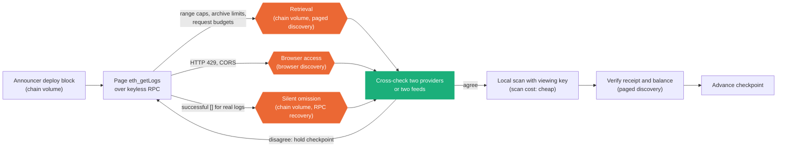

# Methods

## Test keys

**Every key and address in this repository is public, deterministic test material. Never fund them.**

## Terms and units

| Term | Meaning |
| --- | --- |
| announcement | One ERC-5564 `Announcement` event. Generated tables call it a log. |
| page | One `eth_getLogs` response or one feed file |
| window | A block range committed as one unit |
| feed | A prebuilt static set of pages, served over HTTP |
| provider | An RPC operator |
| endpoint | One RPC URL of a provider |
| catch-up | Scan from a checkpoint to head |
| cold rescan | Scan from the first block with no checkpoint |
| Bazzite, Turing node 1–3, M1 | The [hosts](#hosts-and-software) |

Time is in ms, s, min or h. Transfer sizes are in B, kB or MB, memory in MiB or GiB. Ratios use ×.

## Discovery pipeline

Orange stages failed in the recorded runs. Green is the fix.



## Hosts and software

| Label in data | Hardware and OS | Pinning | Used for |
| --- | --- | --- | --- |
| `bazzite` | Desktop, Intel i7-13700K, 32 GB RAM, Bazzite 45 | Wallet on P-core threads 0,2,4,6; paged-discovery chain server on 8,10 | Scan-cost controls and profiles, all later experiments |
| `turing-node-1..3` | Turing Pi RK1 modules (Rockchip RK3588, Cortex-A76 cores 4–7), 8 GB (node 1) / 16 GB (nodes 2–3); kernels 5.10.160-rockchip (node 1), 6.1.0-1012-rockchip (node 2), 6.1.0-1025-rockchip (node 3) | `taskset -c 4-7`; paged-discovery wallet on 4–6, server on 7 | Scan cost (node 1), paged discovery, shared feed |
| Apple M1 | MacBook, Apple M1, 8 GiB RAM | none | Scan-cost initial sweep and retained-set control |

Bun 1.4.4 and the unmodified [`@scopelift/stealth-address-sdk`](https://github.com/ScopeLift/stealth-address-sdk) 1.0.0-beta.5 (`gitHead` [`88bcc27c`](https://github.com/ScopeLift/stealth-address-sdk/tree/88bcc27c3b6163080ee18f330dfd6336dc8bd2e2)). Browser runs use Chromium 150.0.7871.250 in Orca Electron 43.8.10 on `bazzite`.

## Live RPC

Live runs are read-only and keyless, from a residential IP in Europe.

| Experiment | Pacing per provider |
| --- | --- |
| Chain volume | ≤4 requests/s |
| Feed builds | ≤4 requests/s per host |
| RPC recovery | ≥270 ms between request starts |
| Browser-discovery reference, shared feed, spam cost, omission cause, freshness, real announcements | ≥275 ms between request starts |
| Seed recovery | ≥275 ms between request starts; Transfer-log scan ≤600 requests per chain |
| Weekly refresh | ≤4 requests/s per provider, hostnames of one operator together; ≤6,000 requests per endpoint set per chain |

### Weekly refresh

| Item | Rule |
| --- | --- |
| Refreshed | Chain-volume counts, rates and silent recheck ([table](docs/chain-volume.md#weekly-refresh)). All else, hardware timings included, is fixed. |
| Range | Last agreed block + 1 to the lower of two heads minus 15 min of blocks |
| Accept | Two endpoint sets with no provider in common return the same block, log index and tx hash. Otherwise the count holds. |
| Vantage | `--vantage`, or runner kind and Azure region; never an address |

## Browser runs

From the Orca worktree, start the experiment's server, then create a profile and a tab. Each command prints the next one's ID.

```sh
ORCA_CLI="${ORCA_CLI_COMMAND:-orca-ide}"
"$ORCA_CLI" tab profile create --label 'LABEL' --scope isolated --json
"$ORCA_CLI" tab create --url http://127.0.0.1:PORT/ --worktree current --profile PROFILE_ID --headless --json
```

Pass `"$ORCA_CLI"` and the tab's page ID to the runner, with a fresh output directory. Chromium calls providers directly under normal CORS, without credentials. All samples share one profile, so connection and preflight caches can shorten later timings.

## Names in recorded data

Recorded fixtures, seeds and evidence use these phase strings.

| String | Experiment | Where | Why it stays |
| --- | --- | --- | --- |
| `phase2-repeat-v1` | Paged discovery | Default `--seed` of `sweep.ts` and `scripts/paged-discovery.sh` | Prefix of the recorded shuffle seeds in `repeat/<host>/run.json`, which reproduce each `plan.json` order |
| `phase2-wallet`, `phase2-paged-discovery`, `phase2-mainnet-fetch-only` | Paged discovery | `kind` of wallet results, sweep runs and the mainnet probe | Recorded `samples.jsonl` and `run.json` carry these kinds |
| `phase2-test`, `phase2-test-zero` | Paged discovery | Seeds in `test/paged-discovery.test.ts` | Test fixtures only |
| `erc5564-scan-benchmark/phase3 (…)` | Chain volume | User-Agent in `src/chain-volume/http.ts` | Matches the client string providers saw in the recorded run |
| `phase4:base:browser:v1` | Browser discovery | Synthetic fixture seed in `src/browser-discovery/serve.ts` | Reproduces the two recorded matches and decoys |
| `phase4-checkpoint`, `phase5:<name>` | Browser discovery, RPC recovery | localStorage keys during the recorded runs (not stored in `data/`) | Recorded runs only; the code uses `browser-discovery-checkpoint` and `rpc-recovery:<name>` |
| `phase6:base:v1` | Shared feed | Synthetic fixture seed in `src/shared-feed/run.ts` and `tune.ts` | Reproduces the recorded synthetic matches |

## Synthetic fixtures

Scan cost and paged discovery use seeded synthetic announcements, 128 per block and one per transaction.

| Fixture | Recipient |
| --- | --- |
| `zero` | None. Every announcement targets a decoy. |
| `sparse` | Every `matchEvery`-th announcement (default 1,000) |

Verification compares ordered `(blockHash, transactionHash, logIndex)` with multiplicity against the sender schedule. The loader validates every row before timing. It reads view-tag counts from the manifest, so it does not warm ECDH. Seed `erc5564-scan-v1` gives byte-identical `announcements.jsonl`, pinned in [`manifest.json`](data/scan-cost/) and `src/paged-discovery/prepare-fixtures.ts`.

## Scan cost

Each engine, mode and repetition runs in a fresh Bun process, in fixed order. `scanMs` times one complete scan, including allocation and GC, after loading, decoding and key setup.

| Engine or mode | What it does |
| --- | --- |
| `sdk` | Unmodified `getAnnouncementsForUser`, no sender filter or client, eager promises and result allocation included. |
| `crypto` | `checkStealthAddress`: ECDH and hash per entry, then the view-tag check. |
| `noble`, `wasm`, `native` | The same check ([`engines.ts`](src/shared/engines.ts)) on `@noble/secp256k1` 2.3.0 (the SDK's curve), `tiny-secp256k1` 2.2.5 (libsecp256k1 compiled to WebAssembly) or `secp256k1` 5.0.2 (libsecp256k1 N-API addon). keccak256 is `@noble/hashes` 1.8.0 in all three. |
| threads | 2 or 4 Bun workers, one contiguous slice each. Worker start and slice copy (`threadSetupMs`) are outside `scanMs`; CPU time covers all threads. |
| `full` | Scans the whole array once. Models a lost scan checkpoint with retained viewing keys. |
| `incremental` | Scans contiguous batches of retained history, batch and result overhead included. |

`processLifetimePeakRssBytes` includes imports and loading. `syntheticRpcResponseBytes` is the uncompressed size of `{"jsonrpc":"2.0","id":1,"result":[...rawLogs]}`.

| File | Contents |
| --- | --- |
| `run.json` | Options, SDK revision, start time |
| `fixtures/<count>-<case>/announcements.jsonl` | Raw announcements |
| `fixtures/<count>-<case>/manifest.json` | Test viewing keys, destination schedule, tag counts, file digest, synthetic response size |
| `samples.jsonl` | Unrounded verified timings, throughput, CPU time, memory, fixture and lockfile digests, dependency versions, Bun version, OS, CPU and RAM |
| `summary.json` | Per-scenario median/min/max ms, throughput at the median, max lifetime RSS. A single-sample summary is a smoke observation. |

### Scan engines

| Setting | Use |
| --- | --- |
| `scripts/scan-engines.sh bazzite\|turing\|smoke` | Pinned run of every engine and thread count with 100k `crypto` controls before and after; `scripts/record-scan-engines.sh RUN LABEL` copies it to `data/scan-cost/engines/` |
| `REUSE_FIXTURES` | Comma-separated fixture directories, SHA256-checked against the pinned digests |
| `secp256k1` addon | x86-64: the package's prebuild. aarch64: built by `bun install` (`trustedDependencies`) |

### Profiling

`bun run profile` samples the scan with JavaScriptCore every 20 ms and records `node:v8` GC events. On Linux, pass `--native-seconds 0`. GC durations run from prologue to epilogue in microseconds and include concurrent phases ([native observer](https://github.com/oven-sh/bun/blob/38afee6c84fc/src/jsc/bindings/NodeV8.h)). Their sum is not stop-the-world time. `--scan-count 100000` scans a prefix of a larger retained fixture.

## Paged discovery

The wallet uses the scan-cost fixtures and engines. Files are in `src/paged-discovery/`.

| File | Role |
| --- | --- |
| `chain.ts`, `chain-server.ts` | Local JSON-RPC server. Indexes a fixture after checking SHA256 and block order, keeps line offsets and hash indexes in memory, reads announcement bodies from disk. Serves `eth_blockNumber`, `eth_chainId`, `eth_getLogs` (address and topic0, capped at head), `eth_getTransactionReceipt` and `eth_getBalance`. Receipts and balances are synthetic. A control port off the measured path moves the head and reports counters. |
| `link.ts` | TCP link emulator. Counts payload bytes each way, HTTP headers included. Each direction is one FIFO link: delivery = max(arrival, link free) + bytes/bandwidth + one-way latency. |
| `wallet.ts` | One fresh Bun process per sample. Reads the head, then per page: `eth_getLogs`, viem `decodeEventLog` (as the SDK's `getAnnouncements` does), scan, verify each candidate, checkpoint. Verification needs receipt status 1, the announced block, this exact announcement, and a stealth balance covering the announced amount. The checkpoint (`lastScannedBlock` plus matches) is written by atomic rename. One page is resident at a time. |
| `sweep.ts` | Starts one chain per fixture and profile. Per page size it runs a catch-up (scan to head minus `--catchup-blocks`, then to head) and a cold rescan. Records load, memory, swap, `pswpin/out`, thermal zones, CPU MHz and memory PSI around every sample. |

| Profile | RTT | Down | Up |
| --- | --- | --- | --- |
| `none` | 0 (loopback) | unlimited | unlimited |
| `lan` | 1 ms | 1 Gbit/s | 1 Gbit/s |
| `public` | 100 ms | 50 Mbit/s | 20 Mbit/s |

| Field | Covers |
| --- | --- |
| `networkS` | `eth_blockNumber` and every `eth_getLogs`, send to last body byte, server time and link included. No JSON parsing. |
| `decodeS` | JSON.parse of announcement bodies and ABI decoding |
| `scanS` | The unmodified engine per page (`batchSize 0`, one SDK call per page) |
| `verifyS` | Receipt and balance round trips (`verifyNetworkS`) plus local checks |
| `otherS` | Checkpoints and loop overhead. Parts run sequentially and sum to `totalS`. |
| `firstMatchS` | Scan start to the first verified candidate |
| `wireDownMiB`, `wireUpMiB` | TCP payload through the emulator, HTTP headers included, no TCP/IP framing or TLS. `bodyMiB` is JSON-RPC bodies. |
| `peakRssMiB`, `chainRssMiB` | Wallet lifetime peak RSS with imports; server RSS at sample end |

After the timers stop, each sample checks its result and persisted cache against the fixture oracle. Every `eth_getLogs`, receipt and balance call reveals interest to the provider.

### Host runner

`scripts/paged-discovery.sh PLAN` runs the check, tests, fixtures and a sweep, and archives the run under `results/paged-discovery/`.

| Setting | Use |
| --- | --- |
| Plan | `bazzite`, `turing`, `smoke` or a repeat plan in [src/paged-discovery/matrix/](src/paged-discovery/matrix/) |
| `BUN` | Bun override. Defaults to PATH, then `./.runtime/*/bun`. |
| `REUSE_NODE_MODULES`, `REUSE_FIXTURES` | Project with the same lockfile; comma-separated fixture directories, SHA256-checked |
| `HOST_LABEL`, `WALLET_CPUS`, `CHAIN_CPUS`, `CONTROL_CPUS` | Output label and Linux CPU lists. `bazzite` and `repeat-bazzite*` plans default to `bazzite` and the [Bazzite pinning](#hosts-and-software); other plans to the short hostname and no pinning. |
| `MAINNET_RPC` | Optional read-only public RPC probe |
| `REPETITIONS`, `FIRST_REPETITION`, `SEED` | Repeat count, first repeat number, shuffle seed prefix |
| `COOLDOWN_C` | Max thermal zone temperature before each sample. Default 70 °C for `repeat-turing`. |
| `HOST_GATE`, `ALLOW_BUSY_HOST` | Enable the host gate (default for `repeat-bazzite*`), or run anyway and log the override |
| `GATE_MIN_AVAILABLE_GIB`, `GATE_MAX_SWAP_PAGES_PER_S`, `GATE_MAX_PSI_AVG60` | Defaults 8 GiB, 100 pages/s, PSI some avg60 1.0 |

## Spam cost

`bun run spam-cost` writes `data/spam-cost/<chain>.json` and `prices.json`. Nothing is signed or sent.

| Quantity | Source |
| --- | --- |
| Direct gas | `eth_estimateGas` of `announce`, 33-byte ephemeral key, 1-byte metadata |
| Batched gas | `eth_estimateGas` with a state override: a loop contract forwarding the call 1 and 101 times; marginal gas plus the fixed cost spread over 1,000 |
| Fee per gas | Median base fee and median 10th-percentile tip, last 1,024 blocks (`eth_feeHistory`) |
| L1 fee | OP Mainnet, Base: `GasPriceOracle.getL1Fee` of one direct call, spread over 1,000. Arbitrum: included in `eth_estimateGas` |
| Block gas | Latest `gasLimit` × blocks per day. Not a cap on Arbitrum |
| Price | One CoinGecko quote |

## Commands

Runs write under ignored `results/` or `work/` and exit nonzero on an oracle miss. After changing `data/`, regenerate figures and tables. CI fails on stale output.

```sh
bun run figures
bun run tables
```

## Repository layout

| Path | Contents |
| --- | --- |
| `src/shared/` | Fixture generator, scan engines, types, Announcer constants, raw-log decoding and the pinned Base windows, used by several experiments |
| `src/scan-cost/` | Benchmark CLI and profiler |
| `src/paged-discovery/` | Local chain, link emulator, wallet, sweep, reports and repeat matrices |
| `src/chain-volume/` | Keyless endpoint probe, adaptive retriever, indexer clients, report |
| `src/browser-discovery/`, `src/rpc-recovery/` | Browser harnesses |
| `src/shared-feed/` | Feed builder, benchmark, verifier and format search |
| `src/spam-cost/` | Read-only gas, fee and price probe for spam cost |
| `src/freshness/` | Header and tail sampler; hybrid checkpoint logic |
| `src/real-announcements/` | Raw-log fetch and engine scan over real announcements |
| `src/seed-recovery/` | Offline key derivation from a test mnemonic; live feed rediscovery and asset discovery |
| `src/omission-cause/` | Per-provider queries about known omitted announcements |
| `src/phone-bench/` | Phone bench page build, server and result recorder |
| `src/figures/` | `bun run figures` and `bun run tables`: README figures and the generated result tables, from `data/` |
| `scripts/` | `paged-discovery.sh` and `scan-engines.sh`, the host runners |
| `test/` | `bun test` suites and recorded fixtures |
| `data/<experiment>/` | Recorded results ([data/README.md](data/README.md)) |
| `docs/<experiment>.md` | Results per experiment. Tables between `<!-- generated:… -->` markers come from `bun run tables`. |
| `docs/figures/` | SVGs from `bun run figures` |

## Caveats for synthetic experiments

- Synthetic density far exceeds [mainnet density](docs/paged-discovery.md#mainnet-probe).
- The link model has no TLS, compression, provider time, rate limits, jitter or loss. `public` is a what-if, not a provider measurement.
- Fetch, scan and verify run sequentially. A pipelined wallet could hide up to min(network, scan).
- n = 3 is too small for confidence intervals.
- CLI runs only. Browser and mobile timings differ.
