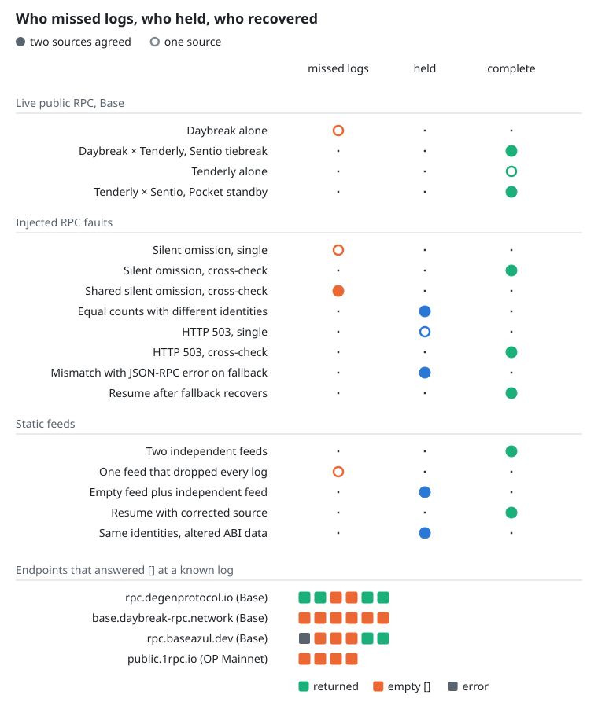

# ERC-5564 scan benchmark

> **No OMR for ERC-5564 yet.** Wallets fetch a public finalized feed in full, scan locally, and advance when two feeds agree.\
> At today's volume OMR costs servers and chain more than it saves phones.\
> [Decision, costs and revisit triggers](docs/shared-feed.md#decision)

Can a wallet find all its ERC-5564 payments from keyless public infrastructure, using ScopeLift's unmodified SDK ([versions](METHODS.md#hosts-and-software))?

> **Never fund any key or address in this repository** ([test keys](METHODS.md#test-keys)).

## Findings

1. [~0.5 ms/announcement (i7), 1.7 ms (A76)](docs/scan-cost.md): scanning is cheap.
2. [28 minutes, 16,296 requests](docs/chain-volume.md): Base's keyless backfill; six other chains took seconds.
3. [0 of 48](docs/rpc-recovery.md): Base logs Daybreak returned, without error; two sources recovered all.
4. [38.8 ms vs 19.3 s](docs/shared-feed.md#feed-against-live-rpc): cold catch-up from two feeds vs live RPC.

Base figures use the [pinned windows](docs/rpc-recovery.md#scope).


<sub>Hollow: one source, which can't tell complete from empty.</sub>


<sub>Feeds on loopback; remote hosting adds round trips.</sub>


<sub>Synthetic scans. Dashes extrapolate; rugs mark real chain histories.</sub>

## More

[Scan cost](docs/scan-cost.md) · [Paged discovery](docs/paged-discovery.md) · [Chain volume](docs/chain-volume.md) · [Browser discovery](docs/browser-discovery.md) · [RPC recovery](docs/rpc-recovery.md) · [Shared feed](docs/shared-feed.md) · [Methods](METHODS.md) · [Data](data/README.md)

## Quickstart

Requires [Bun](https://bun.sh) at the `packageManager` version in `package.json`.

```sh
bun install --frozen-lockfile
bun run check   # tsc --noEmit
bun test        # no network, no mocks
```

## License

[MIT](LICENSE).
