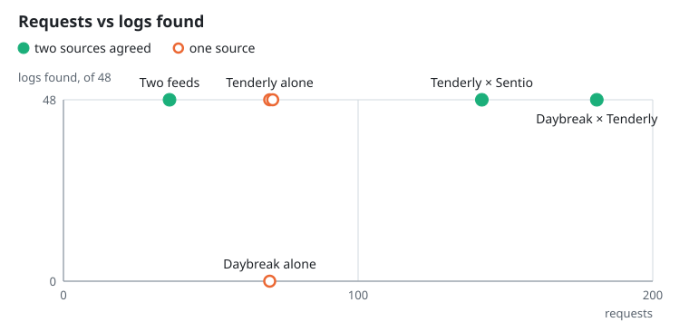

# ERC-5564 scan benchmark

> **No OMR for ERC-5564 yet.** Wallets fetch a public finalized feed in full, scan locally, and advance only when two feeds agree.\
> OMR is cheaper for the phone CPU above ~12/day, but costs servers 4–60 ms per message per recipient and adds ~0.6–2 kB onchain per announcement.\
> Revisit near 100k announcements/day. [Decision](docs/shared-feed.md#decision)

Can a wallet find its ERC-5564 stealth payments from public, keyless infrastructure, and know it found all of them? Measured with ScopeLift's unmodified `@scopelift/stealth-address-sdk` 1.0.0-beta.5 on Bun 1.4.4.

> **All keys and addresses in this repository are public, deterministic test material.
> Never fund them.**

## Findings

1. **Scanning is cheap.** About 0.5 ms per announcement on an i7-13700K and 1.7–1.8 ms on a Cortex-A76; the largest chain history, 102,552 Umbra logs, takes about 180 s on the A76.
2. **Retrieval is the hard part.** Keyless RPCs reached head on all seven chains, but Base took a parallel backfill of 28 minutes and 16,296 requests.
3. **One source can't prove completeness; two can.** Daybreak returned 0 of 48 known Base logs without an error. Cross-checked against Tenderly, it returned 48/48 for 111 more requests.
4. **A static feed catches up faster than RPC.** Cold catch-up over the same 48 logs took 38.8 ms from two loopback feeds and 19.3 s over live RPC.

The three Base figures use 68 pinned windows of 1,000 blocks holding 48 known logs, recorded 2026-11-26.


<sub>Hollow marks: one source, which ends without error whether it found 48 logs or 0. Endpoint rows cover all seven chains.</sub>


<sub>Requests against logs found. Feeds ran on loopback; remote hosting adds round trips.</sub>


<sub>Logs accepted over wall time, one browser run per strategy. Daybreak alone finishes on time with 0 of 48.</sub>


<sub>Synthetic zero-match scans on the i7 and A76. Dashes extrapolate linearly; rugs mark each chain's full history.</sub>


<sub>Requests to fetch each chain's full history over keyless RPC, one run per strategy. Hollow: stopped before head.</sub>

## More

[Scan cost](docs/scan-cost.md) · [Paged discovery](docs/paged-discovery.md) · [Chain volume](docs/chain-volume.md) · [Browser discovery](docs/browser-discovery.md) · [RPC recovery](docs/rpc-recovery.md) · [Shared feed](docs/shared-feed.md) · [Methods, hardware and layout](METHODS.md) · [Recorded data](data/README.md)

## Quickstart

Requires [Bun](https://bun.sh) at the `packageManager` version in `package.json`.

```sh
bun install --frozen-lockfile
bun run check   # tsc --noEmit
bun test        # no network, no mocks
bun run bench --sizes 256 --match-every 16 --batch-size 37 --repetitions 1
```

## License

[MIT](LICENSE).
