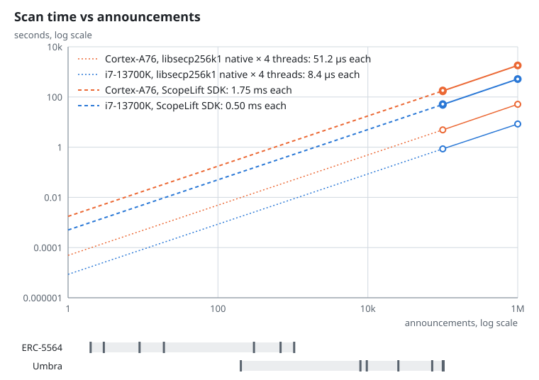

# ERC-5564 scan benchmark

Can a wallet find its ERC-5564 stealth payments from public, keyless infrastructure, and know it found all of them? Measured with ScopeLift's unmodified `@scopelift/stealth-address-sdk` 1.0.0-beta.5 on Bun 1.4.4.

> **All keys and addresses in this repository are public, deterministic test material.
> Never fund them.**

## Findings

1. **Scanning is cheap at real volume.** Every chain's full ERC-5564 history would scan in seconds ([Scan cost](docs/scan-cost.md)).
2. **Retrieval is the hard part.** Keyless RPCs reached head on all seven chains, but Base only with a parallel backfill ([Chain volume](docs/chain-volume.md)). Over a public link, page size decides whether the network matters ([Paged discovery](docs/paged-discovery.md)).
3. **Cross-checking fixes completeness cheaply.** A second RPC, or two independent static feeds, recovered every omitted log and held the checkpoint while sources disagreed ([RPC recovery](docs/rpc-recovery.md), [Shared feed](docs/shared-feed.md)).


<sub>Filled: accepted only what two sources agreed on. Hollow: one source, so a complete result can't be told from a silent omission; runs that miss logs end without an error, and only scoring against the frozen reference shows the misses. Live rows: Base, 68 pinned windows, in a browser. Fault and feed rows: the same windows on loopback. Endpoint rows: keyless endpoints rechecked twice at known announcements; 65 of 87 on 7 chains returned every known log, and the rest errored on at least one check or, as shown, answered `[]` without an error. Data: `data/rpc-recovery/summary.json`, `data/shared-feed/summary.json` and `evidence.json`, `data/chain-volume/consistency/*.json`. Details: [RPC recovery](docs/rpc-recovery.md), [Shared feed](docs/shared-feed.md), [Chain volume](docs/chain-volume.md).</sub>


<sub>Base, the same 68 windows of 1,000 blocks with 48 known logs. RPC requests are POSTs, feed requests GETs. "Tenderly alone" is two runs: browser (70 POST) and Bun client (71 POST). A single source that finds 48 looks the same as one that finds 0; nothing in the run says which. Feeds ran on loopback (38.8 ms); remote hosting adds round trips that time does not include. Data: `data/rpc-recovery/summary.json` (browser runs), `data/shared-feed/summary.json` (Bun client and feeds). Details: [RPC recovery](docs/rpc-recovery.md), [Shared feed](docs/shared-feed.md).</sub>


<sub>One browser run per strategy, Base, 68 pinned windows of 1,000 blocks, 2026-11-26. Daybreak alone finishes on time with 0 of 48 logs. Tenderly × Sentio has Pocket on standby; Daybreak × Tenderly uses Sentio as tiebreak. A step is a window committed with new logs, timed when its last log request ended. Pacing is ≥270 ms between requests per provider. Data: `data/rpc-recovery/live-*.json` (requests and browser resource timings). Details: [RPC recovery](docs/rpc-recovery.md).</sub>


<sub>Lines: synthetic zero-match fixtures, crypto engine, on the i7-13700K (Bazzite) and Cortex-A76 (Turing node 1). Dots are measured (100k controls before and after, 1M run); dashes are a linear extrapolation (1M / 100k measured at 9.9–10.7x). Rugs: each chain's full history from deployment to head, 7 chains, 2026-11-26: ERC-5564 2–1,039 and Umbra 202–102,552 per chain. The largest (Umbra, 102,552) would take about 180 s on the A76. Every scan-time estimate in this repo uses these scan-cost 100k controls (i7 48.5–52.0 s), not the paged-discovery controls (i7 47.3–47.6 s). Data: `data/scan-cost/results.csv`, `data/chain-volume/summary.csv`, `data/chain-volume/umbra/retrieve-*.json`. Details: [Scan cost](docs/scan-cost.md), [Chain volume](docs/chain-volume.md).</sub>


<sub>Keyless public RPC, one run per strategy from a residential IP, ≤4 requests/s per host, 2026-11-26. Hollow bar: stopped before head. Parallel backfill was run only where needed. Data: `data/chain-volume/summary.csv` (list-order, probe-informed and parallel requests). Details: [Chain volume](docs/chain-volume.md).</sub>

## More

[Scan cost](docs/scan-cost.md) · [Paged discovery](docs/paged-discovery.md) · [Chain volume](docs/chain-volume.md) · [Browser discovery](docs/browser-discovery.md) · [RPC recovery](docs/rpc-recovery.md) · [Shared feed](docs/shared-feed.md) · [Methods, hardware and layout](METHODS.md) · [Recorded data](data/README.md)

## Quickstart

Requires [Bun](https://bun.sh) at the `packageManager` version in `package.json`.

```sh
bun install --frozen-lockfile
bun run check   # tsc --noEmit
bun test        # no network, no mocks
bun run bench --sizes 256 --match-every 16 --batch-size 37 --repetitions 1
```

## License

[MIT](LICENSE).
