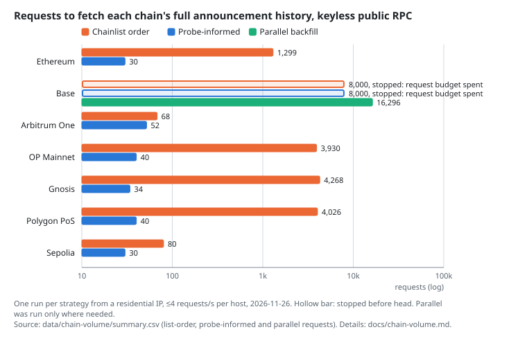
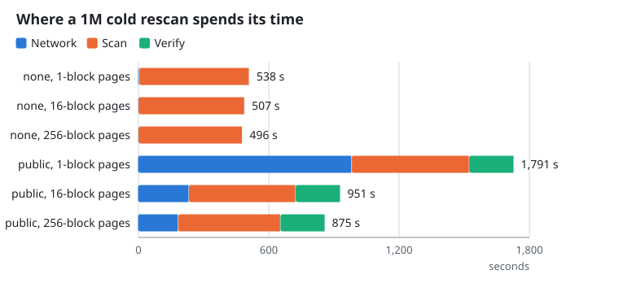

# ERC-5564 scan benchmark

Measures stealth payment discovery and keyless announcement retrieval with ScopeLift's unmodified `@scopelift/stealth-address-sdk` 1.0.0-beta.5 on Bun 1.4.4.

> **All keys and addresses in this repository are public, deterministic test material.
> Never fund them.**

## Findings so far

Figures and tables below are generated from [`data/`](data/README.md) by `bun run figures` and `bun run tables`. Each one links to the doc that has the method and caveats.

**Scanning is cheap at real volume. Retrieval and completeness are the hard part.** Every chain's full ERC-5564 history would scan in seconds. Scan time is extrapolated from the synthetic scan-cost runs ([Scan cost](docs/scan-cost.md), [Chain volume](docs/chain-volume.md)).


**Base is the outlier for keyless backfill.** Only parallel backfill reached head ([Chain volume](docs/chain-volume.md)).



**On a public link, page size decides whether the network matters.** Verification adds a fixed cost per payment ([Paged discovery](docs/paged-discovery.md)).



**Who recovered the logs a Base RPC silently dropped** ([RPC recovery](docs/rpc-recovery.md), [Shared feed](docs/shared-feed.md)):

<!-- generated:recovery-matrix -->
| Strategy | Experiment | Scope | Logs found | Requests | Time |
| --- | --- | --- | ---: | ---: | ---: |
| Daybreak alone | [RPC recovery](docs/rpc-recovery.md) | Base, 68 pinned windows × 1,000 blocks, live, browser | 0/48 ✗ | 70 POST | 18.69 s |
| Daybreak cross-checked with Tenderly, Sentio as tiebreaker | [RPC recovery](docs/rpc-recovery.md) | Base, 68 pinned windows × 1,000 blocks, live, browser | 48/48 ✓ | 181 POST | 31.25 s |
| Tenderly alone | [RPC recovery](docs/rpc-recovery.md) | Base, 68 pinned windows × 1,000 blocks, live, browser | 48/48 ✓ | 70 POST | 18.82 s |
| Live RPC, Bun client | [Shared feed](docs/shared-feed.md) | Base, 68 pinned windows × 1,000 blocks, live | 48/48 ✓ | 71 POST | 19.33 s (median of 3) |
| Two independent static feeds | [Shared feed](docs/shared-feed.md) | Base, 68 pinned windows × 1,000 blocks, **loopback** | 48/48 ✓ | 36 GET | 38.8 ms (median of 3, loopback) |
| One feed that dropped every log | [Shared feed](docs/shared-feed.md) | Base, 68 pinned windows × 1,000 blocks, **loopback** | 0/48 ✗ | 18 GET | 9.2 ms (loopback) |
| Same feed plus an independent feed, then resume with a corrected source | [Shared feed](docs/shared-feed.md) | Base, 68 pinned windows × 1,000 blocks, **loopback** | held, then 48/48 ✓ | 8 + 34 GET | 36.8 ms after resume (loopback) |
<!-- /generated:recovery-matrix -->

**Discovery approaches side by side.** Scopes differ by row. Compare rows only where their scope matches.

<!-- generated:approaches -->
| Approach | Experiment | Scope | Requests | Time | Complete | In a browser |
| --- | --- | --- | ---: | ---: | --- | --- |
| Local scan of fetched announcements | [Scan cost](docs/scan-cost.md) | Synthetic 100k, no network | 0 | 48.5–52.0 s (i7), 168.5–181.9 s (A76) | Fixture oracle ✓ | No (Bun CLI) |
| Paged JSON-RPC, cold rescan | [Paged discovery](docs/paged-discovery.md) | Synthetic 1M, emulated 100 ms / 50 Mbit/s link, 256-block pages, i7 | — | 875.4 s median | Fixture oracle ✓ | No (Bun CLI) |
| Keyless RPC, sequential adaptive | [Chain volume](docs/chain-volume.md) | Base, deploy block to head, live | 8,000 | 39 min | ✗ budget spent at 462 of 679 | No (Bun CLI) |
| Keyless RPC, parallel backfill | [Chain volume](docs/chain-volume.md) | Base, deploy block to head, live | 16,296 | 28 min | ✓ 679 logs | No (Bun CLI) |
| Public RPC with a saved cursor | [Browser discovery](docs/browser-discovery.md) | Base, 5,000 blocks, live | 12 fresh / 6 resumed | 1.58–4.44 s fresh, 0.71–2.21 s resumed | 3 of 6 endpoints exact | Yes |
| One public RPC (Daybreak) | [RPC recovery](docs/rpc-recovery.md) | Base, 68 pinned windows × 1,000 blocks, live | 70 POST | 18.69 s | ✗ 0/48 | Yes |
| Cross-checked RPCs | [RPC recovery](docs/rpc-recovery.md) | Base, 68 pinned windows × 1,000 blocks, live | 181 POST | 31.25 s | ✓ 48/48 | Yes |
| Two static feeds | [Shared feed](docs/shared-feed.md) | Base, 68 pinned windows × 1,000 blocks, **loopback** | 36 GET | 38.8 ms (loopback) | ✓ 48/48 | No (Bun client) |
<!-- /generated:approaches -->

## Experiments

| Experiment | Question | Short answer (figures in each doc) |
| --- | --- | --- |
| [Scan cost](docs/scan-cost.md) | How long does a local scan take? | Time grows linearly with history. ECDH point arithmetic dominates. |
| [Paged discovery](docs/paged-discovery.md) | What does a wallet pay to page through history over RPC? | On a fast link, scanning dominates. On a public link, page size decides whether the network matters. |
| [Chain volume](docs/chain-volume.md) | How many announcements exist, and can a keyless client fetch them? | Very few. Keyless retrieval reached head on all seven chains. Base needed parallel backfill. |
| [Browser discovery](docs/browser-discovery.md) | Can a browser wallet discover from public RPCs? | On half the Base RPCs tested. A saved cursor cut requests on each one that completed. |
| [RPC recovery](docs/rpc-recovery.md) | Can a wallet recover logs an RPC silently omits? | Not from one RPC. Cross-checking a second provider recovered every omitted log. |
| [Shared feed](docs/shared-feed.md) | Can a static feed replace live RPC? | Yes, with two independent feeds. The client holds its checkpoint when they disagree, and the feed needs fewer requests than live RPC. |

Run order: scan cost, paged discovery, chain volume, browser discovery, RPC recovery, shared feed. Each experiment reuses data or code from earlier ones.

## Hardware

| Label in data | Hardware | Used for |
| --- | --- | --- |
| `bazzite` | Desktop, Intel i7-13700K, 32 GB RAM, Bazzite Linux; wallet pinned to P-core threads 0,2,4,6 | Scan-cost controls and profiles, all later experiments |
| `turing-node-1..3` | Turing Pi RK1 modules (Rockchip RK3588, Cortex-A76 cores used), 8 GB (node 1) / 16 GB (nodes 2-3) | Scan-cost controls and profiles (node 1), paged discovery, shared feed |
| Apple M1 | MacBook, Apple M1, 8 GiB RAM | Scan-cost initial sweep and retained-set control only |

## Quickstart

Requires [Bun](https://bun.sh) at the `packageManager` version in `package.json`.

```sh
bun install --frozen-lockfile
bun run check   # tsc --noEmit
bun test        # no network, no mocks
bun run bench --sizes 256 --match-every 16 --batch-size 37 --repetitions 1
```

[Methods and layout](METHODS.md) · [Recorded results](data/README.md)

## License

[MIT](LICENSE).
