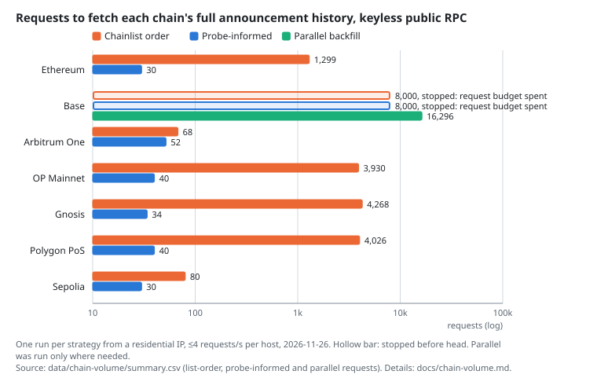

# Chain volume

How many ERC-5564 announcements exist per chain, and can a keyless client fetch them all? On all seven chains, yes. Of 190 endpoints probed, 105 answered `eth_getLogs` and 77 accepted the deploy-block query.

One `bazzite` run on 2026-11-26 under the [live RPC rules](../METHODS.md#live-rpc), canonical Announcer `0x55649E01B5Df198D18D95b5cc5051630cfD45564`, deployment to measured head. HTTP 429 backoff honors Retry-After. User-Agent `erc5564-scan-benchmark/phase3 (public keyless log-retrieval study)` ([why `phase3`](../METHODS.md#names-in-recorded-data)).

## Per chain

Sources agree on `(block, logIndex)` and transaction hash. "Full history": the endpoint accepted a deploy-block window.

<!-- generated:chain-volume -->
| Chain | Deploy block | Announcements | First - last announcement | Per month (since first) | Keyless endpoints: listed / probed / answered getLogs / full history | Max span of full-history endpoints, blocks: median [min-max] | Best keyless cold start | Naive cold start (chainlist order) | Keyless indexers |
| --- | ---: | --- | --- | ---: | --- | --- | --- | --- | --- |
| Ethereum | 20,042,207 | **298**: Blockscout v2 = Routescan = RPC (2 endpoint sets) | 21,140,089 (2024-11-08) - 26,499,925 (2026-11-26) | 12.1 (30-36 in each of the last 3 months) | 72 / 36 / 17 / 11 | 1,001 [10 - whole history]; 2 took the whole history | OK, exact: 8 s, 30 requests, 335 KiB | OK, exact: 26 min, 1,299 requests | Blockscout v2 OK (50/page); Routescan OK (100/page, ~441 blocks behind head); Blockscout etherscan-API timed out (90 s) or 429 |
| Base | 15,502,414 | **679**: RPC only (matches both partial runs on their silent-free prefixes) | 16,819,551 (2024-07-08) - 62,245,129 (2026-11-25) | 23.7 | 41 / 33 / 16 / 11 (3 of the 11 return silent empty results) | 1,001 [10 - 63,752] (none took the whole history) | OK, parallel: 28 min, 16,296 requests, 1,394 KiB | FAILED: 8,000-request budget spent at 17% of history (34 min, 457 announcements so far) | Blockscout: Cloudflare challenge (blocked); Basescan/Etherscan: key required |
| Arbitrum One | 219,468,264 | **19**: RPC (2 endpoint sets agree) | 434,497,958 (2026-02-21) - 522,929,374 (2026-11-10) | 2.1 | 35 / 27 / 15 / 12 | 551 [10 - whole history]; 1 took the whole history | OK: 14 s, 52 requests, 26 KiB | OK: 17 s, 68 requests | Blockscout: Cloudflare challenge (blocked) |
| OP Mainnet | 121,097,390 | **2**: Blockscout v2 = Blockscout etherscan-API = RPC | 154,353,397 (2026-07-17) - 154,455,081 (2026-07-20) | 0.5 | 36 / 25 / 18 / 13 | 5,001 [50 - whole history]; 2 took the whole history | OK, exact: 10 s, 40 requests, 4 KiB | OK, exact: 18 min, 3,930 requests | Blockscout (explorer.optimism.io) OK |
| Gnosis | 34,349,356 | **3**: RPC (2 endpoint sets agree) | 40,967,594 (2025-07-07) - 41,054,058 (2025-07-12) | 0.2 | 25 / 20 / 10 / 9 | 10,000 [101 - whole history]; 3 took the whole history | OK: 17 s, 34 requests, 5 KiB | OK: 72 min, 4,268 requests | Blockscout: Cloudflare challenge (blocked) |
| Polygon PoS | 57,888,814 | **9**: RPC (2 endpoint sets agree) | 85,999,710 (2026-04-25) - 95,895,782 (2026-10-21) | 1.3 | 40 / 28 / 15 / 10 | 1,001 [51 - whole history]; 2 took the whole history | OK: 12 s, 40 requests, 12 KiB | OK: 17 min, 4,026 requests | Blockscout: Cloudflare challenge (blocked) |
| Sepolia | 5,486,597 | **1,039**: Routescan = RPC (2 endpoint sets); **Blockscout has 1,026** | 6,241,244 (2024-07-04) - 12,186,737 (2026-11-22) | 36.1 | 30 / 21 / 14 / 11 | 10,001 [50 - whole history]; 2 took the whole history (one 3-block value excluded: a head-lag artifact, see caveats) | OK: 8 s, 30 requests, 1,227 KiB | OK: 66 s, 80 requests | Blockscout v2 and etherscan-API: 13 missing; Routescan OK |
<!-- /generated:chain-volume -->

Probe-informed runs rank deploy-block-capable endpoints by span; list-order runs take Chainlist order among endpoints that answered a 10-block query. Both start at 10,000 blocks, adapt, and use up to eight endpoints. Parallel (Base only) splits the range into 64 resumable chunks. Deploy blocks come from Blockscout creation transactions or `eth_getCode` bisection, confirmed on two more endpoints.


<sub>Hollow: stopped before head.</sub>

## Findings

1. **Whole-history queries work on six chains**, via Tenderly, or rpc.gnosischain.com and gateway.fm on Gnosis. Base needed four parallel workers over Pocket, two Tenderly hostnames, thirdweb and Sentio; sequential 1,000-block requests would need ~47,000 calls, over three hours.
2. **Recent access can hide archive limits.** publicnode wanted a token for history on five chains; blockreq served the last 1,024 blocks, blockmachine 100–10,000, thyme and blazingnode 128. Per chain, 28–53% of probed endpoints failed `eth_getLogs`.
3. **Successful responses can omit logs.** Base's `base.daybreak-rpc.network`, `rpc.degenprotocol.io` and `rpc.baseazul.dev`, and OP's `public.1rpc.io`, passed the deploy-block probe but returned `[]` for known announcements (four OP misses in 50-block windows). The Base probe-informed run switched to Daybreak at block 34,304,282, found nothing more, and spent its 8,000 requests by block 46,544,282 ([skipped logs](rpc-recovery.md#scope)). Pocket on OP succeeded once, then reported pruned history; its spans ranged 10,438–70,538 blocks despite a 10,001-block error.
4. **Indexers miss logs too.** Blockscout v2 missed 13 Sepolia logs in blocks 11,909,881–11,926,046 at 0–2 blocks of head lag: it had the transactions, but `/transactions/{hash}/logs` returned HTTP 500. Its first Ethereum fetch lacked transaction hashes on 263 of 296 rows, so that comparison used block and log index. Routescan lagged 51–471 blocks on Ethereum and Sepolia.

## Wallet guidance

1. Start at the deployment block; store the next unscanned block per chain and key, and advance only after a successful scan.
2. On range, size, timeout or range-worded 429 errors, use the reported limit or halve the span; grow after successes. 1,000 blocks worked on most historical endpoints.
3. Try the user's RPC first, then fallbacks by cap; switch on archive errors and record which endpoint served each range.
4. [Cross-check](rpc-recovery.md) empty windows against an independent source, and mark history incomplete until catch-up.

| Chain | Observed starting spans |
| --- | --- |
| Ethereum | 5,000 on BlockPI. Whole history on Tenderly. |
| Base | 1,000 on Tenderly. About 10,000 on Pocket, with unstable results. Daybreak, Degen Protocol and Base Azul silently omitted logs. |
| Arbitrum | 10,000,000 on arb1. Whole history on Tenderly. |
| OP Mainnet | 10,000 on mainnet.optimism.io. Whole history on Tenderly. |
| Gnosis | Whole history on rpc.gnosischain.com. |
| Polygon | 10,000 on QuickNode public. Whole history on Tenderly. |
| Sepolia | Whole history on Tenderly. |

## ScopeLift SDK default

The pinned SDK's `getAnnouncements` calls `fetchLogsInChunks`. Without `fromBlock` it walks from block 0 to head in sequential 5,000-block chunks, with no retry, range adaptation or fallback; one failed chunk fails the call.

| Chain | Requests from block 0 | Requests from the deploy block | Keyless endpoints that accept 5,000 blocks and serve the deploy block |
| --- | ---: | ---: | --- |
| Ethereum | 5,300 | 1,292 | 5 (xrpc.cl, BlockPI, Tenderly ×2, Pocket) |
| Base | 12,512 | 9,412 | 1 (Pocket, whose history and limits vary by backend) |
| Arbitrum One | 105,550 | 61,656 | 4 |
| OP Mainnet | 32,011 | 7,791 | 7 |
| Gnosis | 9,896 | 3,027 | 7 |
| Polygon PoS | 19,600 | 8,022 | 4 |
| Sepolia | 2,444 | 1,347 | 7 |

Endpoints capped below 5,000 blocks reject the first request. At median latency, a scan from block 0 takes 7–28 minutes on Ethereum and 1.5–3.4 hours on Arbitrum.

## Endpoint behavior

Candidates come from chainlist.org [`rpcs.json`](https://chainlist.org/rpcs.json), fetched 2026-11-26T14:02Z (SHA-256 `bd7786b2…0996a`, [`endpoints.json`](../data/chain-volume/endpoints.json)), minus keyed URLs, templates, websockets and relay or MEV endpoints: 21–36 per chain.

[`probe.ts`](../src/chain-volume/probe.ts) checks chain ID, head and a 10-block `eth_getLogs`, searches the max span ending at head (×4 from 1,000 blocks, round limits, bisection), tests archive depth down to the deploy block and the first known announcement, and takes 10 latency samples at ≤1,000 blocks.

The consistency check asked each full-history endpoint twice for 100-block windows around the first, middle and last known announcement: 65 of 87 returned every log; the rest errored or answered `[]`.

Errors are stored verbatim (first 300 characters) and classified; the classifier is tested on 139 recorded messages ([`rpc-errors.json`](../test/fixtures/chain-volume/rpc-errors.json)).

| Message (verbatim, trimmed) | Code | Meaning |
| --- | --- | --- |
| `You can make eth_getLogs requests with up to a 10 block range` (Blast) | -32600 | 10 blocks |
| `Block range too large: maximum allowed is 50 blocks on your current plan` (Nodies) | -32001 | 50 |
| `eth_getLogs is limited to 0 - 50 blocks range` (1rpc) | -32602 | 50 |
| `ranges over 100 blocks are not supported on free plan` (dRPC) | 35 | 100 |
| `Requested range is over limit of 100` (Tatum) | -16412 | 100 |
| `public eth_getLogs is limited to 1000 blocks` (Sentio, as HTTP 429) | 8 | 1,000 |
| `invalid params (Block range too large: maximum 1000 blocks without an API key)` (Tenderly on Base) | -32602 | 1,000 |
| `Log response size exceeded. Maximum allowed number of requested blocks is 1000` (thirdweb) | -32005 | 1,000 |
| `query exceeds max block range 2000` (daybreak, Base) | -32602 | 2,000 |
| `eth_getLogs is limited to 5000 block range` (BlockPI) | -32602 | 5,000 |
| `eth_getLogs is limited to a 10,000 range` (QuickNode Polygon, mainnet.optimism.io) | -32614 | 10,000 |
| `exceed maximum block range: 50000` (publicnode Base) | -32701 | 50,000 |
| `Archive requests require a personal token` (publicnode) | -32602 | no keyless history |
| `pruned history unavailable: requested 15502414, earliest available 51000000` (1rpc Base) | 4444 | no history before block 51M |
| `keyless requests are served for the most recent 100 blocks only` (blockmachine) | -32002 | recent only |

- No endpoint hit a result-count cap on the canonical Announcer. Tenderly served each chain's whole Umbra history in 31–55 requests, with windows up to 2^26 blocks (1.4 MB per response on Arbitrum) and on OP twice refused a too-large result, so the client halved the window.
- Fixed indexer pages (Blockscout v2 50, etherscan-API 1,000, Routescan 100) cost at least count/page requests.
- Rate or quota limits came from Tatum (5 per minute, Retry-After 60), OnFinality, routeme.sh (Retry-After 1), mainnet.base.org, thyme, thirdweb, Sentio and the Blockscout etherscan-compatible API (`rateLimitHits` in `endpoints.csv`).
- Median `eth_getLogs` time of full-history endpoints: Ethereum 126 ms, Base 127, Arbitrum 122, OP 107, Gnosis 96, Polygon 110, Sepolia 69; range 42–924 ms, worst p95 2.0 s (10 samples, so near the maximum).

## Umbra and uncountable systems

Umbra predates ERC-5564 and uses its own contract, `0xFb2dc580Eed955B528407b4d36FfaFe3da685401`, with event `Announcement(address indexed receiver, uint256 amount, address indexed token, bytes32 pkx, bytes32 ciphertext)`. Counted like the Announcer.

| Chain | Umbra deploy block | Umbra announcements | First - last | Canonical ERC-5564 Announcer |
| --- | ---: | ---: | --- | ---: |
| Ethereum | 12,343,914 | 25,558 | 2021-05-18 - 2026-11-24 | 298 |
| Base | 10,761,374 | 7,955 | 2024-02-20 - 2026-11-20 | 679 |
| Arbitrum One | 7,285,883 | 100,196 | 2022-03-18 - 2026-11-16 | 19 |
| OP Mainnet | 4,069,556 | 72,277 | 2022-03-18 - 2026-11-06 | 2 |
| Gnosis | 28,237,950 | 202 | 2023-06-08 - 2026-02-18 | 3 |
| Polygon PoS | 20,750,142 | 102,552 | 2021-11-03 - 2026-11-18 | 9 |
| Sepolia | 3,539,169 | 9,690 | 2023-05-31 - 2026-11-23 | 1,039 |

Counts are raw, spam and test traffic included. Blockscout v2 returned 9,659 on Sepolia; its pagination and Routescan's stopped short on the large sets.

Systems without an announcement log can't be counted. [Fluidkey](https://docs.fluidkey.com/technical-documentation/technical-walkthrough)'s server derives stealth addresses and ephemeral keys from the user's private viewing key ([Dedaub audit, May 2024](https://dedaub.com/audits/fluidkey/fluidkey-stealth-account-kit-may-24-2024/)), so payments look like ordinary transfers to fresh Safe accounts. Off-chain ephemeral keys leave nothing to count, and shielded pools (Railgun, Privacy Pools, Aztec) work differently. Other contracts may emit similar events.

## Caveats

- One run per strategy; caps hold for that date. Some endpoints shut down that day, and Pocket, routeme and xrpc changed answers within minutes.
- A deploy-block query counts as full history even if it omits logs; the consistency check covers three logs per chain. Indexer references exist only for Ethereum, OP and Sepolia; elsewhere only RPC runs agree, on Base outside the silent ranges.
- Spans end at head, so recent-only endpoints report their recent window. A lagging Sepolia publicnode backend gave a spurious 3-block span ("block range extends beyond current head", now classed transient).
- No browser CORS test. Blockscout Cloudflare challenges count as blocked; don't retry them automatically.

## Reproduce

```sh
bun test test/chain-volume.test.ts   # no network: recorded error bodies, simulated endpoints
# live, read-only, keyless; each stage writes JSON under results/chain-volume/ (--output to change)
bun run chain-volume --stage endpoints                  # fetch and filter chainlist rpcs.json
bun run chain-volume --stage reference                  # Blockscout / Routescan counts and deploy blocks
bun run chain-volume --stage probe                      # limits, archive depth, latency (~10-25 min per chain)
bun run chain-volume --stage retrieve                   # full history, list-order and probe-informed
bun run chain-volume --stage retrieve --chains base --strategy parallel --max-requests 60000 --max-minutes 300   # resumable: rerun to continue
bun run chain-volume --stage consistency,verify-deploy  # silent-miss check, deploy block recheck
bun run chain-volume --stage umbra-reference,umbra-retrieve,umbra-verify-deploy
bun run chain-volume --stage report                     # summary.md/csv, endpoints.csv, cross-source.csv
```

`--chains` takes `ethereum,base,arbitrum,optimism,gnosis,polygon,sepolia`. The probe and the naive cold start make several thousand requests per chain. Later stages read earlier ones from the same `--output`, skipping hosts flagged by saved consistency results. `--output data/chain-volume` replaces the recorded data.

[Raw results](../data/chain-volume/) · [Run metrics](../data/chain-volume/summary.md) · [Endpoints](../data/chain-volume/endpoints.csv) · [Source comparisons](../data/chain-volume/cross-source.csv) · [Consistency checks](../data/chain-volume/consistency/) · [Umbra](../data/chain-volume/umbra/) · [Code](../src/chain-volume/)
