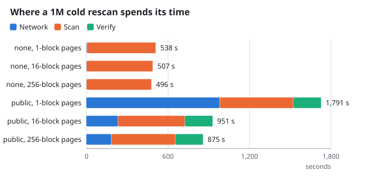
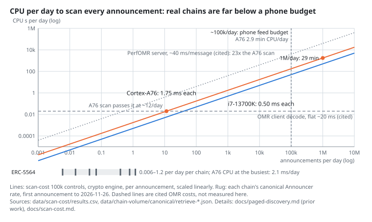

# Paged discovery

What does a wallet pay to find its payments by paging through history over JSON-RPC? On a fast link, scanning is 94–97% of the cost. On a 100 ms, 50 Mbit/s link, page size decides whether the network matters, and verification adds about 0.205 s per payment. Catch-up cost depends on the new blocks, not the history.

Medians [min–max] of three repetitions on 2026-11-25/26. Each fresh wallet process matched the sender schedule by ordered `(blockHash, transactionHash, logIndex)` outside the timers.

[Per-run evidence](../data/paged-discovery/) · [Repeat statistics](../data/paged-discovery/repeat.csv) · [Samples and host state](../data/paged-discovery/repeat-samples.csv) · [Single-run CSV](../data/paged-discovery/single-run.csv) · [Method](../METHODS.md#paged-discovery) · [Hardware](../METHODS.md#hardware)

## Findings

1. **On a fast link, discovery is scanning.** On `none` the scan is 94–97% of a cold rescan on both hosts. Fetching 107 MiB of logs per 100k announcements takes 0.2–0.5 s on Bazzite and 0.6–1.3 s on the Pi. 1M/100k is 9.95–10.1x. The Pi is 3.6–3.7x slower than the i7 on medians: 3.4–3.6x on the cool node 3, 3.9–4.3x on the throttled node 2. `lan` was not repeated. Its single-run scan share was 89–96%.
2. **On a public link, page size decides whether the network matters.** With 1-block pages at 1M, the Bazzite network term (983 s) exceeds the scan (542 s). From 64 blocks per page the network sits at the bandwidth floor: 18.7–19.7 s per 100k on Bazzite and 19.0–20.0 s on the Pi, about 1.1 KB per announcement uncompressed. 16-block pages take 23.5–23.7 s. Network terms vary by under 1%, so the spread in totals comes from the scan.

   
3. **Verification is a fixed tax per payment.** Two calls per candidate cost 0.2052–0.2082 s at 100 ms RTT for every page size, history, host and node. That is 20.53–20.82 s per 100 payments and 205.2–205.8 s for 1,000. It is 23.4% of the best public-link total on Bazzite (100k and 1M) and 9.8% on the Pi. No number in the study is less noisy.
4. **Bigger pages delay the first match and raise memory.** First-match time is about one page's fetch and scan. Peak RSS is 103–283 MiB up to 64 blocks and 498–749 MiB for cold rescans at 256 blocks (32,768 logs, ~28 MiB per response). History size adds little, except +11% at 256 blocks (726 against 654 MiB, matching the single run's 723 against 654). Scan cost held the whole fixture and needed ~3.9 GiB at 1M.
5. **Catch-up depends on the new blocks, not the history.** On `public`, 1-block pages mean 64 round trips and double the cost. Small pages also scan slower through the SDK wrapper, 1-block against 256-block: 8% (100k) and 6% (1M) on Bazzite, 11% on every Pi node. The single run showed ~10%. The cause was not isolated.

All five single-run findings (Appendix A) held in the repeats, with finding 4's history effect and finding 5's slowdown refined.

## Cold rescans (median [min–max], n = 3)

<!-- generated:paged-cold -->
| Host | Size | Profile | Page blocks | Network s | Scan s | Verify s | Total s | First match s | Wallet peak RSS MiB | Single-run total s |
| --- | ---: | --- | ---: | ---: | ---: | ---: | ---: | ---: | ---: | ---: |
| Bazzite i7-13700K | 100,000 | none | 1 | 0.5 [0.4-0.5] | 51.3 [51.2-51.5] | 0.10 [0.10-0.12] | 54.1 [54.1-54.3] | 0.09 [0.09-0.09] | 143 [142-143] | 54.0 |
| Bazzite i7-13700K | 100,000 | none | 16 | 0.2 [0.2-0.2] | 49.0 [48.8-49.4] | 0.12 [0.10-0.12] | 50.9 [50.6-51.2] | 1.09 [1.08-1.09] | 174 [172-178] | 51.9 |
| Bazzite i7-13700K | 100,000 | none | 64 | 0.2 [0.2-0.2] | 48.6 [48.6-49.0] | 0.08 [0.08-0.09] | 50.3 [50.3-50.7] | 4.08 [4.08-4.08] | 231 [230-235] | 51.3 |
| Bazzite i7-13700K | 100,000 | none | 256 | 0.2 [0.2-0.3] | 47.3 [47.2-48.1] | 0.05 [0.05-0.05] | 49.0 [48.8-49.8] | 16.11 [16.10-16.48] | 654 [654-658] | 49.3 |
| Bazzite i7-13700K | 100,000 | public | 1 | 98.6 [98.4-98.6] | 53.8 [52.8-54.2] | 20.55 [20.53-20.56] | 178.6 [177.1-178.8] | 0.53 [0.53-0.54] | 152 [150-157] | 177.4 |
| Bazzite i7-13700K | 100,000 | public | 16 | 23.5 [23.5-23.6] | 49.3 [49.1-51.0] | 20.59 [20.54-20.63] | 95.3 [95.2-96.7] | 1.88 [1.87-1.97] | 176 [175-186] | 97.2 |
| Bazzite i7-13700K | 100,000 | public | 64 | 19.7 [19.6-19.7] | 48.5 [48.3-48.8] | 20.59 [20.53-20.59] | 90.4 [90.2-90.5] | 6.00 [5.98-6.03] | 282 [282-283] | 90.8 |
| Bazzite i7-13700K | 100,000 | public | 256 | 18.7 [18.7-18.7] | 47.2 [47.1-47.3] | 20.54 [20.54-20.57] | 87.9 [87.8-88.0] | 22.46 [22.40-22.54] | 658 [657-660] | 88.0 |
| Bazzite i7-13700K | 1,000,000 | none | 1 | 4.7 [4.7-5.3] | 507.7 [504.4-508.3] | 0.98 [0.92-1.07] | 538.1 [536.1-538.5] | 0.09 [0.08-0.09] | 151 [147-151] | 565.2 |
| Bazzite i7-13700K | 1,000,000 | none | 16 | 2.2 [2.2-2.2] | 488.5 [487.3-498.0] | 1.06 [1.05-1.08] | 507.1 [505.6-516.4] | 1.09 [1.08-1.10] | 180 [179-180] | 521.3 |
| Bazzite i7-13700K | 1,000,000 | none | 256 | 2.2 [2.2-2.2] | 478.6 [472.9-515.8] | 0.47 [0.47-0.47] | 495.8 [489.9-533.2] | 16.13 [16.12-17.45] | 726 [724-749] | 496.4 |
| Bazzite i7-13700K | 1,000,000 | public | 1 | 983.3 [982.3-984.2] | 541.9 [524.4-549.1] | 205.29 [205.20-205.31] | 1,791.2 [1,763.7-1,826.4] | 0.53 [0.51-0.54] | 159 [158-162] | 1,730.6 |
| Bazzite i7-13700K | 1,000,000 | public | 16 | 234.4 [233.5-234.5] | 491.7 [490.0-504.8] | 205.76 [205.46-205.79] | 951.3 [949.7-961.7] | 1.90 [1.88-1.95] | 198 [198-201] | 949.4 |
| Bazzite i7-13700K | 1,000,000 | public | 256 | 184.7 [184.6-184.7] | 471.0 [470.4-475.6] | 205.20 [205.17-205.23] | 875.4 [875.1-880.4] | 22.51 [22.37-22.62] | 672 [672-674] | 878.1 |
| Turing RK1 A76 (nodes 1-3) | 100,000 | none | 1 | 1.3 [1.2-1.4] | 192.1 [181.9-221.8] | 0.28 [0.23-0.30] | 199.5 [189.6-230.6] | 0.37 [0.35-0.37] | 122 [122-125] | 204.7 |
| Turing RK1 A76 (nodes 1-3) | 100,000 | none | 16 | 0.6 [0.5-0.7] | 179.3 [178.5-190.5] | 0.27 [0.23-0.29] | 185.3 [184.7-197.1] | 3.97 [3.97-4.07] | 149 [148-150] | 192.0 |
| Turing RK1 A76 (nodes 1-3) | 100,000 | none | 64 | 0.6 [0.5-0.6] | 173.2 [166.3-189.7] | 0.20 [0.17-0.24] | 179.5 [172.2-196.6] | 14.60 [14.45-15.02] | 236 [232-243] | 185.9 |
| Turing RK1 A76 (nodes 1-3) | 100,000 | none | 256 | 0.6 [0.6-0.7] | 172.9 [163.3-191.9] | 0.26 [0.25-0.33] | 179.3 [169.7-199.0] | 56.71 [55.84-58.95] | 500 [499-520] | 185.9 |
| Turing RK1 A76 (nodes 1-3) | 100,000 | public | 1 | 98.4 [98.4-98.5] | 195.4 [193.1-202.9] | 20.60 [20.59-20.62] | 321.1 [319.0-329.1] | 0.81 [0.78-0.83] | 113 [108-114] | 319.3 |
| Turing RK1 A76 (nodes 1-3) | 100,000 | public | 16 | 23.7 [23.7-23.8] | 175.3 [174.5-193.0] | 20.75 [20.74-20.82] | 226.3 [225.5-244.2] | 4.71 [4.71-4.83] | 141 [140-144] | 228.6 |
| Turing RK1 A76 (nodes 1-3) | 100,000 | public | 64 | 20.0 [20.0-20.0] | 169.7 [166.5-184.9] | 20.78 [20.78-20.82] | 216.4 [213.4-231.9] | 16.43 [16.34-17.20] | 221 [219-225] | 218.0 |
| Turing RK1 A76 (nodes 1-3) | 100,000 | public | 256 | 19.0 [18.9-19.0] | 167.5 [162.9-189.5] | 20.77 [20.66-20.78] | 212.6 [208.4-234.9] | 62.82 [62.22-65.33] | 498 [498-499] | 219.3 |
| Turing RK1 A76 (nodes 1-3) | 1,000,000 (zero-match) | none | 64 | 5.4 [5.2-5.9] | 1,821.0 [1,692.0-2,038.4] | 0.00 [0.00-0.00] | 1,883.2 [1,751.1-2,110.0] | - | 248 [248-250] | 1,882.3 |
<!-- /generated:paged-cold -->

Pi rows pool nodes 1–3, one sample each. The single-run column is Bazzite, or Turing node 1 for the Pi.

## 64-block catch-up (8,192 announcements, 8 payments; median [min–max], n = 3)

<!-- generated:paged-catchup -->
| Host | History | Profile | Page blocks | Total s | Verify s | Single-run total s |
| --- | ---: | --- | ---: | ---: | ---: | ---: |
| Bazzite i7-13700K | 100,000 | none | 1 | 4.43 [4.39-4.50] | 0.01 [0.01-0.01] | 4.56 |
| Bazzite i7-13700K | 100,000 | none | 16 | 4.21 [4.17-4.23] | 0.01 [0.01-0.01] | 4.48 |
| Bazzite i7-13700K | 100,000 | none | 256 | 4.01 [3.99-4.20] | 0.01 [0.01-0.01] | 4.06 |
| Bazzite i7-13700K | 100,000 | public | 1 | 14.52 [14.45-14.71] | 1.65 [1.65-1.66] | 14.67 |
| Bazzite i7-13700K | 100,000 | public | 16 | 7.83 [7.81-7.88] | 1.65 [1.65-1.65] | 7.96 |
| Bazzite i7-13700K | 100,000 | public | 256 | 7.34 [7.33-7.38] | 1.65 [1.64-1.66] | 7.37 |
| Bazzite i7-13700K | 1,000,000 | none | 1 | 4.46 [4.42-4.56] | 0.01 [0.01-0.01] | 4.50 |
| Bazzite i7-13700K | 1,000,000 | none | 16 | 4.21 [4.18-4.27] | 0.01 [0.01-0.01] | 4.32 |
| Bazzite i7-13700K | 1,000,000 | none | 256 | 4.01 [4.00-4.02] | 0.01 [0.01-0.01] | 4.15 |
| Bazzite i7-13700K | 1,000,000 | public | 1 | 14.73 [14.70-14.74] | 1.65 [1.65-1.65] | 14.34 |
| Bazzite i7-13700K | 1,000,000 | public | 16 | 7.89 [7.83-7.89] | 1.65 [1.65-1.66] | 7.89 |
| Bazzite i7-13700K | 1,000,000 | public | 256 | 7.36 [7.35-7.36] | 1.65 [1.65-1.65] | 7.36 |
| Turing RK1 A76 (nodes 1-3) | 100,000 | none | 1 | 15.60 [15.48-16.05] | 0.03 [0.03-0.03] | 16.76 |
| Turing RK1 A76 (nodes 1-3) | 100,000 | none | 16 | 14.78 [14.72-15.24] | 0.02 [0.02-0.03] | 15.22 |
| Turing RK1 A76 (nodes 1-3) | 100,000 | none | 256 | 14.55 [14.20-14.89] | 0.03 [0.02-0.03] | 15.64 |
| Turing RK1 A76 (nodes 1-3) | 100,000 | public | 1 | 26.43 [26.30-26.67] | 1.65 [1.65-1.66] | 26.84 |
| Turing RK1 A76 (nodes 1-3) | 100,000 | public | 16 | 18.47 [18.44-19.09] | 1.66 [1.65-1.66] | 18.68 |
| Turing RK1 A76 (nodes 1-3) | 100,000 | public | 256 | 17.70 [17.68-18.39] | 1.66 [1.66-1.67] | 18.06 |
<!-- /generated:paged-catchup -->

## Controls (scan-cost crypto engine, 100k zero-match, unprofiled)

| Host / node | Before s | After s | Drift | Max C | Throttle state | Note |
| --- | ---: | ---: | ---: | ---: | ---: | --- |
| Bazzite | 47.584 | 47.274 | 0.7% | 84 | n/a | ~2% faster than scan cost (48.5-52.0) and the single run (48.5/48.2) |
| Turing node 1 | 168.285 | 172.364 | 2.4% | 86.8 | 2 | inside the scan-cost range (168.5-181.9) |
| Turing node 2 | 188.253 | 187.562 | 0.4% | 86.8 | 3 | throttles to 1800 MHz; above the scan-cost range |
| Turing node 3 | 161.612 | 161.231 | 0.2% | 61.9 | 0 | never throttled (2256 MHz); below the scan-cost range |

The Pi nodes differ by up to 17% because of cooling. Nodes 1 and 2 reach 85–87 C and drop to thermal-cpufreq states 1–4 within a 20 s sample. Node 3 stays under 62 C. Node 3 was fastest and node 2 slowest in every cold scan. The 1M zero-match rescan took 1751 s, 1883 s and 2110 s on nodes 3, 1 and 2.

## Design

| Host | Setup |
| --- | --- |
| Bazzite (wallet cores 0,2,4,6, server 8,10) | Cold 100k sparse at 1/16/64/256 blocks and 1M sparse at 1/16/256. Catch-up on both histories at 1/16/256. `none` and `public`. Three repetitions, 78 samples, 5.1 h. |
| Turing nodes 1–3 (wallet A76 cores 4–6, server 7) | Kernel 5.10 on node 1, 6.1 on nodes 2–3. Cold 100k sparse at 1/16/64/256 and catch-up at 1/16/256 on both profiles, plus 1M zero-match cold at 64 blocks on `none`. One repetition per node in parallel, 45 samples, ~2.2 h. The spread mixes run and node effects. |

- Each repetition shuffles its [matrix](../src/paged-discovery/matrix/) with the seed in `plan.json`, between 100k crypto controls. Hosts record temperature, CPU frequency, throttle state, swap traffic and memory PSI every 2 s. Turing waited up to 281 s for all zones below 70 C. Node 3 never waited.
- The Bazzite gate (≥8 GiB available, ≤100 swap pages/s over 10 s, PSI some avg60 ≤1.0) passed at 18.2 GiB, 1.8 pages/s, PSI 0.00 and load 1.3, with 5.7 GiB of parked zram.
- Bun 1.4.4, lockfile `d17ecebb...`. Fixtures were generated on the M1, SHA256-checked, and rechecked after copying. `bun run check` and `bun test` (88/88) passed on each host.
- Single run only: `lan`, 10k, 4-block pages and Bazzite 1M at 64 blocks.

## Bazzite host activity

An IDE and `kwin_wayland` grew during the first hour. MemAvailable fell from 17.4 to 12.8 GiB, zram rose from 5.7 to 14.4 GiB, and 1-minute load peaked at 10.9 before sample 9 of 78. Load then stayed at 0.9–2.7, with 10.4–11.1 GiB available. The wallet peaked at 750 MiB and chain servers at 46–708 MiB.

A sample is flagged if any 2 s interval exceeds 100 swap pages/s or memory PSI avg10 1.0. The flag marks 23 of 78 samples, mostly in that first hour. Flagged samples were within −0.3% to +2.0% of unflagged peers, with two exceptions:

| Sample | Setting | Condition | Flagged | Unflagged |
| --- | --- | --- | ---: | ---: |
| 9 | 1M `public`, 1 block | load 10.9, PSI avg10 9.1 | 1826 s (+3.6%) | 1764 s |
| 22 | 1M `none`, 256 blocks | 23k swap pages/s | 533 s (+8%) | 490/496 s |

All three samples of the second setting are flagged; the other two agree within 1.2%. Both outliers are their group's max, so medians hold, and dropping all flagged samples changes no finding. Flags are the `tainted` column in [`repeat-samples.csv`](../data/paged-discovery/repeat-samples.csv). Intel has no thermal-cpufreq device, so Bazzite has no throttle state. The package reached 100 C only in samples 8–9.

The single run on this host swapped heavily. Its 1M `none` totals at 1 and 16 blocks (565.2 and 521.3 s) were 3–5% above the repeat ranges. Turing node 1 throttled, and its 64–256-block totals fell in the slow half of the repeats. The single-run 1M `public` 1-block total (1731 s) was 3.5% below the repeat median.

## Caveats

[Shared caveats](../METHODS.md#caveats-for-synthetic-experiments) cover the synthetic workload, deterministic link, sequential stages, RSS and three-sample ranges. The first scheduled match is at index 0, so first-match time measures the first page. The Pi 1M fixture has no matches and no verification cost.

## Mainnet fetch-only probe

One run from Turing node 1 against keyless `ethereum-rpc.publicnode.com`, [canonical Announcer](chain-volume.md). Blocks 26,484,827–26,494,826 returned 14 announcements in 10 requests of 1000 blocks, 55–92 ms each, 1.1 KB per decoded log, brotli on the wire. Older ranges returned HTTP 403 "Archive requests require a personal token", which ended the probe under the no-credential rule. [`mainnet-fetch.json`](../data/paged-discovery/mainnet-probe/mainnet-fetch.json)

## Prior work and OMR crossover

- The [ScopeLift SDK](https://github.com/ScopeLift/stealth-address-sdk) reads RPC `getLogs` in chunks, or a subgraph with an `id_lt` cursor and pinned `snapshotBlock`.
- [umbra-js](https://github.com/ScopeLift/umbra-protocol/blob/master/umbra-js/src/classes/Umbra.ts) tries the indexer, then one unchunked RPC call to `latest`.
- [Fluidkey](https://docs.fluidkey.com/technical-documentation/technical-walkthrough) shares a viewing-key BIP-32 node with its server, which implies server-side scanning.
- None of this code handles reorgs or cross-checks sources.

| Scheme | Cost |
| --- | --- |
| [OMR](https://eprint.iacr.org/2021/1256) | ~$1 server cost per 1M messages scanned, ~20 ms client decode |
| [DoS-resistant OMR](https://eprint.iacr.org/2024/510) | ~4.9 ms server per message per recipient, 12x faster than OMRp2 |
| [PerfOMR](https://eprint.iacr.org/2024/204) | ~40 ms server per message (PerfOMR2), ~600 B clue. Not DoS-resistant: a crafted clue breaks it |
| [SophOMR](https://eprint.iacr.org/2024/1814) | 3.4x faster than PerfOMR |



Bandwidth is the other side of the budget: 1M/day is ~100 MB at ~100 B per announcement, and OMR adds ~0.6–1 kB of clue per announcement.

The 1-byte view tag gives 1/256 false positives and skips the final derivation, not the ECDH. Draft EIP-7745 (log index with Merkle proofs) and EIP-7792 (verifiable `eth_getLogs`) could prove a feed page complete. [Envio](https://docs.envio.dev/blog/nodes-silently-miss-events) documents silent `getLogs` omissions (Erigon #16364, Nethermind #9178). I found no published design for signed or Merkle-committed ERC-5564 feed pages.

## Reproduce

Set `FIXTURE_DIRS` to comma-separated fixture directories and `NODE` to the Pi node (1–3). For reports, set `BAZZITE_RUN` and `TURING_RUN_*` to the host run directories.

```sh
bun run src/paged-discovery/prepare-fixtures.ts --output work/fixtures \
  --fixtures 100000-zero,10000-sparse,100000-sparse,1000000-sparse   # checked against pinned digests
bun run paged-discovery --fixtures work/fixtures/100000-sparse --pages 1,16,64,256 \
  --profiles none,public --scenarios cold,catchup \
  --control-fixture work/fixtures/100000-zero --output results/paged-discovery-my-run   # one sweep
# repeats: 3 shuffled repetitions between controls; matrices in src/paged-discovery/matrix/
scripts/paged-discovery.sh repeat-bazzite        # Bazzite, host-gated, ~5.2 h
REUSE_FIXTURES="$FIXTURE_DIRS" HOST_LABEL="turing-node-$NODE" FIRST_REPETITION="$NODE" REPETITIONS=1 \
  WALLET_CPUS=4,5,6 CHAIN_CPUS=7 CONTROL_CPUS=4-7 scripts/paged-discovery.sh repeat-turing   # per Pi node, ~2.2 h
scripts/paged-discovery.sh repeat-smoke          # 5-minute check of the repeat path
bun run src/paged-discovery/repeat-report.ts --host "bazzite=$BAZZITE_RUN" --host "turing=$TURING_RUN_1" \
  --host "turing=$TURING_RUN_2" --host "turing=$TURING_RUN_3" --csv summary.csv --samples-csv samples.csv --md table.md
# original single run (Appendix A)
scripts/paged-discovery.sh bazzite
REUSE_FIXTURES="$FIXTURE_DIRS" WALLET_CPUS=4,5,6 CHAIN_CPUS=7 CONTROL_CPUS=4-7 scripts/paged-discovery.sh turing
bun run src/paged-discovery/report.ts --host "bazzite=$BAZZITE_RUN" --host "turing-node-1=$TURING_RUN_1" --csv single-run.csv --md table.md
# optional read-only mainnet probe, never mixed into results
bun run paged-discovery:mainnet --rpc https://ethereum-rpc.publicnode.com --output results/mainnet-probe
```

---

# Appendix A: single run (2026-11-25, one repetition per configuration)

Same hosts and pinning, Turing node 1 only, fixed setting order. [Comparison with the repeats](#bazzite-host-activity)

## A. Controls (scan-cost crypto engine, 100k zero-match, unprofiled)

<!-- generated:paged-single-controls -->
| Host | Before s | After s | Scan-cost range s |
| --- | ---: | ---: | --- |
| Bazzite | 48.509 | 48.235 | 48.531-51.951 |
| Turing node 1 (10k/100k sweep) | 177.044 | 176.762 | 168.457-181.946 |
| Turing node 1 (1M run) | 177.087 | 174.666 |  |
<!-- /generated:paged-single-controls -->

Control drift was 0.6% (Bazzite) and 0.2%/1.4% (Pi), inside the scan-cost runs' 7–8%.

## A. Cold rescans

<!-- generated:paged-single-cold -->
| Host | Size | Profile | Page blocks | Network s | Scan s | Verify s | Total s | First match s | Wire down MiB | Wallet peak RSS MiB |
| --- | ---: | --- | ---: | ---: | ---: | ---: | ---: | ---: | ---: | ---: |
| Bazzite i7-13700K | 100,000 | none | 1 | 0.6 | 51.1 | 0.1 | 54.0 | 0.09 | 107 | 146 |
| Bazzite i7-13700K | 100,000 | none | 16 | 0.2 | 50.0 | 0.2 | 51.9 | 1.17 | 107 | 168 |
| Bazzite i7-13700K | 100,000 | none | 256 | 0.2 | 47.6 | 0.1 | 49.3 | 16.18 | 107 | 654 |
| Bazzite i7-13700K | 100,000 | public | 1 | 98.2 | 56.2 | 20.5 | 177.4 | 0.55 | 107 | 160 |
| Bazzite i7-13700K | 100,000 | public | 16 | 23.3 | 51.8 | 20.5 | 97.2 | 2.01 | 107 | 180 |
| Bazzite i7-13700K | 100,000 | public | 256 | 18.6 | 47.4 | 20.5 | 88.0 | 22.48 | 107 | 658 |
| Bazzite i7-13700K | 1,000,000 | none | 1 | 6.3 | 532.6 | 1.2 | 565.2 | 0.09 | 1073 | 157 |
| Bazzite i7-13700K | 1,000,000 | none | 16 | 2.4 | 502.4 | 1.4 | 521.3 | 1.13 | 1072 | 179 |
| Bazzite i7-13700K | 1,000,000 | none | 256 | 2.4 | 478.7 | 0.5 | 496.4 | 16.29 | 1072 | 723 |
| Bazzite i7-13700K | 1,000,000 | public | 1 | 979.4 | 520.0 | 205.0 | 1730.6 | 0.52 | 1073 | 165 |
| Bazzite i7-13700K | 1,000,000 | public | 16 | 231.6 | 497.2 | 205.2 | 949.4 | 1.89 | 1072 | 197 |
| Bazzite i7-13700K | 1,000,000 | public | 256 | 184.5 | 474.3 | 204.9 | 878.1 | 22.50 | 1072 | 671 |
| Turing Pi A76 | 100,000 | none | 1 | 1.2 | 196.9 | 0.3 | 204.7 | 0.40 | 107 | 122 |
| Turing Pi A76 | 100,000 | none | 16 | 0.6 | 185.5 | 0.3 | 192.0 | 4.07 | 107 | 150 |
| Turing Pi A76 | 100,000 | none | 256 | 0.5 | 179.4 | 0.3 | 185.9 | 61.42 | 107 | 487 |
| Turing Pi A76 | 100,000 | public | 1 | 98.3 | 193.7 | 20.6 | 319.3 | 0.80 | 107 | 111 |
| Turing Pi A76 | 100,000 | public | 16 | 23.7 | 177.7 | 20.7 | 228.6 | 4.75 | 107 | 139 |
| Turing Pi A76 | 100,000 | public | 256 | 18.9 | 174.1 | 20.7 | 219.3 | 66.47 | 107 | 497 |
| Turing Pi A76 | 1,000,000 (zero-match) | none | 64 | 5.2 | 1818.8 | 0.0 | 1882.3 | - | 1070 | 250 |
<!-- /generated:paged-single-cold -->

64-block catch-up (8,192 announcements, 8 payments), total seconds, including about 1.65 s of verification on `public`:

<!-- generated:paged-single-catchup -->
| Host | none | lan | public, 1-block pages | public, 16-256-block pages |
| --- | --- | --- | --- | --- |
| Bazzite (100k and 1M histories) | 4.1-4.6 | 4.3-5.0 | 14.3-14.7 | 7.4-8.0 |
| Turing node 1 (100k history) | 15.1-16.8 | 15.6-17.0 | 26.8 | 18.1-18.7 |
<!-- /generated:paged-single-catchup -->

## A. Findings

| Topic | Single-run result |
| --- | --- |
| Scanning | ECDH and view-tag checks took 89–97% of cold rescans on `none`/`lan`. Fetching 107 MiB per 100k cost 0.2–3.9 s. Bazzite scaled ~10x from 100k to 1M. The Pi took 3.6–3.9x as long as the i7. |
| Network | At 1M with 1-block pages, Bazzite spent 979 s fetching and 520 s scanning, 1731 s total. At 16–64 blocks per page the network approached 18–19 s per 100k. Fastest 100k totals: 88 s (Bazzite), 219 s (Pi). |
| Verification | ~0.205 s per payment at 100 ms RTT: 23% (Bazzite) and 9% (Pi) of the best public-link totals. |
| First match and memory | At 1 against 256 blocks per page: Bazzite 0.09 against 16–22 s, Pi 0.4 against 61–66 s. Peak RSS 110–280 MiB up to 64 blocks, 470–720 MiB at 256. History size had little effect at smaller pages. |
| Catch-up | Bazzite took 4.1–4.5 s for 64 blocks on both histories. On `public`, 14.7 s at 1 block against 7.4 s at larger pages. The 1M scan took 532.6 s at 1 block against 478.7 s at 256. |

## A. Caveats

The [shared caveats](#caveats) apply. Bazzite swap grew from 2.2 to 11.5 GiB (~2.9M more `pswpout` pages), with 12–17 GiB available, wallet RSS under 1 GiB and drift within 0.6%. The Pi throttled at 80–86 C (~2.0 of 2.26 GHz) and used a 1M zero-match fixture to save ~1 h of generation. The 1M chain server used ~400 MiB, mostly hash indexes.

The [single-run CSV](../data/paged-discovery/single-run.csv) has every host, size, scenario, profile and page size, with requests, stage times, first match, wire bytes and RSS.
