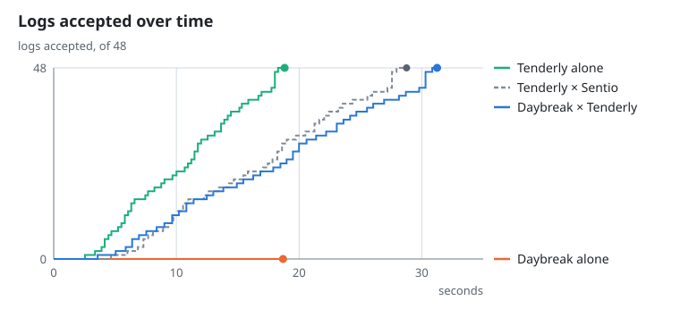

# RPC recovery

Can a browser wallet recover announcements that a provider silently drops?

Yes in these windows: a two-provider cross-check recovers every announcement Daybreak drops.

<!-- generated:recovery-live -->
| Live strategy | Accepted / expected logs | RPC POSTs | Third-provider pages | Wall time |
| --- | ---: | ---: | ---: | ---: |
| Daybreak, original-width diagnostic | 0 / 48 observed | 36 | 0 | 9.52 s to probe 34 pages |
| Daybreak single | 0 / 48 | 70 | 0 | 18.69 s |
| Daybreak + Tenderly, Sentio fallback | 48 / 48 | 181 | 39 | 31.25 s |
| Tenderly single | 48 / 48 | 70 | 0 | 18.82 s |
| Tenderly + Sentio, Pocket on standby | 48 / 48 | 142 | 0 | 28.76 s |
<!-- /generated:recovery-live -->

One run per row, 2026-11-26 at about 20:00 UTC, with no extra identities or transport errors. The Daybreak cross-check calls Sentio on 39 mismatches and accepts 29 empty agreements. POST counts include startup calls to every provider, standby included.


<sub>Each step is a window committed with new announcements.</sub>

## Injected faults

Loopback fixtures replay the frozen reference, with one loopback path per provider.

<!-- generated:recovery-faults -->
| Fixture | Committed windows | Missed in committed windows | Expected in pending windows | RPC POSTs | Third-provider pages | Elapsed |
| --- | ---: | ---: | ---: | ---: | ---: | ---: |
| Silent omission, single | 68 | 48 | 0 | 70 | 0 | 145.6 ms |
| Silent omission, cross-check | 68 | 0 | 0 | 181 | 39 | 278.6 ms |
| Shared silent omission, cross-check | 68 | 48 | 0 | 142 | 0 | 214.7 ms |
| Equal counts with different identities | 13 | 0 | 45 | 35 | 1 | 46.6 ms to stop |
| HTTP 503, single | 7 | 0 | 48 | 10 | 0 | 17.1 ms to stop |
| HTTP 503, cross-check | 68 | 0 | 0 | 143 | 1 | 210.7 ms |
| Mismatch with JSON-RPC error on fallback | 7 | 0 | 48 | 23 | 1 | 30.6 ms to stop |
| Resume after fallback recovers | 68 | 0 | 0 | 167 | 39 | 254.1 ms after resume |
<!-- /generated:recovery-faults -->

The mismatch-plus-error run stops before blocks 41,623,282–41,624,281. Shared upstreams can agree falsely: the shared-omission run commits every window empty.

## Windows

In [chain volume](chain-volume.md#findings), Daybreak returns no announcements in 6,120 successful 2,000-block pages through block 46,544,281. The replay takes its 29 non-empty pages plus five empty controls. The original-width row queries these 34 pages as is. The other rows split them into 68 windows of 1,000 blocks with 48 known announcements. Completeness holds for these windows only.

Tenderly and Sentio scanned the ranges independently, in 1,000- and 613-block steps, and agree on head hash, chain ID and all 48 receipt-checked identities.

## Method

These are [browser runs](../METHODS.md#browser-runs) on port 8784. Single RPC commits any successful page. Cross-check calls a third provider on an error or disagreement and commits on two agreeing responses.

```sh
bun run rpc-recovery:serve data/rpc-recovery/reference.json results/rpc-recovery-replay
bun run rpc-recovery "$ORCA_CLI" PAGE_ID data/rpc-recovery/reference.json results/rpc-recovery-replay   # all (default), live or fixture
bun run rpc-recovery:verify data/rpc-recovery/reference.json results/rpc-recovery-replay > results/rpc-recovery-replay/summary.json
bun run rpc-recovery:verify data/rpc-recovery/reference.json data/rpc-recovery   # recorded samples
bun run rpc-recovery:reference results/rpc-recovery-replay/reference-rediscovery.json   # recapture
```

[Pinned reference](../data/rpc-recovery/reference.json) · [Browser samples](../data/rpc-recovery/) · [Verified metrics](../data/rpc-recovery/summary.json) · [CORS controls](../data/rpc-recovery/controls.json)
