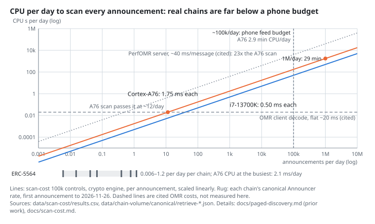
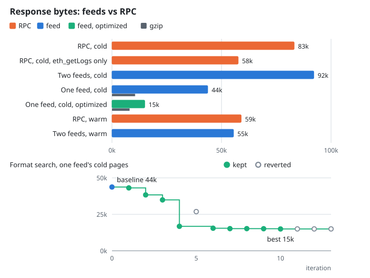

# Shared feed

Should wallets use a shared static feed or OMR?

A shared feed. Two feeds recover every announcement in milliseconds, and OMR costs servers per message per recipient.

## Decision

Clients fetch every finalized feed page, scan locally, resume from a checkpoint, and retry a window when the two feeds disagree. Signed page commitments wait for log indexes with proofs: drafts [EIP-7745](https://eips.ethereum.org/EIPS/eip-7745), [EIP-8304](https://eips.ethereum.org/EIPS/eip-8304) or EIP-7792. No published design signs ERC-5564 feed pages. Erigon #16364 and Nethermind #9178 are [silent `getLogs` omissions](https://docs.envio.dev/blog/nodes-silently-miss-events).

No DoS-resistant OMR variant runs in production.

| Scheme | Detector ms/msg, 1 / 2 threads | Recipient ms | Clue bytes | DoS-resistant |
| --- | ---: | ---: | ---: | --- |
| [OMRp2](https://eprint.iacr.org/2021/1256) | 59.8 / 30.1 | 11 | 956 | Yes (2024/510 Lemma 4.3, §7.3) |
| [PerfOMR1](https://eprint.iacr.org/2024/204) | 4.1 / 2.1 | 21 | 2,181 | No (attacks in 2024/510 §5.1, §7.4, §8) |
| [PerfOMR2](https://eprint.iacr.org/2024/204) | 21.5 / 11.3 | 11 | 583 | No |
| [DoS-PerfOMR](https://eprint.iacr.org/2024/510) | 4.9 / 2.6 | 20 | 1,996 | Yes (2024/510 Theorem 7.2) |

Rows are [eprint 2024/510](https://eprint.iacr.org/2024/510) Table 1: N = 2^19 messages, γ = γ̄ = 50, one GCP n4-standard-8 with SEAL HEXL / AVX512-IFMA52. Detector time is per scanned message, for one recipient's digest. Table 2 gives DoS-PerfOMR 4.95 ms/msg amortized. Table 1 cites Theorem 5.3, which 7.2 builds on. Citations use revisions 2022-04-14 (2021/1256), 2024-11-21 (2024/204) and 2025-02-07 (2024/510, latest). [2021/1256](https://eprint.iacr.org/2021/1256) puts server cost at ~$1 per million messages. [SophOMR](https://eprint.iacr.org/2024/1814) reports 3.4× the speed of PerfOMR.


<sub>Solid lines scale the scan-cost controls. Dashed OMR lines are single-thread literature values on one cloud AVX512 core.</sub>

Each chain averaged 0.006–1.2 announcements per day to 2026-11-26, at most 2.1 ms CPU per day on Turing. The Turing scan passes DoS-PerfOMR's 20 ms recipient time at ~12/day.

| Revisit when | Assumed budget | Breaks at |
| --- | --- | ---: |
| Daily Turing scan time | 3 min CPU at 1.75 ms each | ~100k/day |
| Daily feed bytes | 60 MB at ~620 B (2 × best format) | ~100k/day |
| Wallets cover Umbra-scale streams | — | ~100k per chain |

The budgets are assumptions. At 1M/day, Turing needs 29 min.

## Privacy

Privacy does not change the decision. A full download is OMR's full-scan baseline ([2021/1256](https://eprint.iacr.org/2021/1256) §1); both leak only IP and timing.

| Path | Observer | Learns | Source |
| --- | --- | --- | --- |
| Per-wallet `eth_getLogs` | RPC provider | IP, sync times, block ranges; same filter for all | [`wallet.ts`](../src/paged-discovery/wallet.ts) |
| RPC receipt, balance | RPC provider | Your stealth addresses, tied to IP | [METHODS.md](../METHODS.md), `verifyCandidate` |
| Full feed download | Feed host, CDN | IP, fetch times, last checkpoint (inferred) | [Method](#method) |
| Feed retries, later calls | Feed host; RPC provider | Retries mark feed disagreement; later checks leak as RPC, linkable by timing (inferred) | — |
| OMR detection | Detector | Nothing about pertinence | 2021/1256 §4.2, Def. 4.1; [2024/204](https://eprint.iacr.org/2024/204) §1; [2024/510](https://eprint.iacr.org/2024/510) §7.1 |
| OMR keys and queries | Detector | Query time, k̄, IP; identity only if keys link (OMRp2, DoS-PerfOMR: unlinkable); ~129 MB key | 2021/1256 §9.1, §9.3, §12; 2024/510 Remark 7.3 |
| OMR DoS | Recipients | Honest-but-curious detector assumed; crafted PerfOMR clues overflow recipients into retry or full download | 2021/1256 §8.1; 2024/510 §5.1, §7.1, §7.4 |
| ERC-5564 view tag | Everyone | 1 secret byte (128 → 124 bits); a viewing-key scanner sees all matches | [ERC-5564](https://eips.ethereum.org/EIPS/eip-5564) "Parsing considerations"; 2021/1256 §1 |

OMR wins past the 60 MB/day feed budget, where wallets would fetch selectively or delegate a viewing key (inferred). [OMR Landscape](https://hackmd.io/@keewoolee/SJfUTqER-x) ("Recommendation (TL;DR)") calls FHE OMR "far-fetched" near term.

## Feed against live RPC

<!-- generated:shared-feed -->
| Path | Mode | Exact logs in sampled range | POST / GET | Request / response body bytes | Fetch (ms) | Scan (ms) | Page verification (ms) | First synthetic match (ms) | Catch-up (ms), median [min–max] |
| --- | --- | ---: | ---: | ---: | ---: | ---: | ---: | ---: | ---: |
| Live RPC | Cold | 48/48 | 71 / 0 | 16,679 / 83,147 | 6,834 | 41.4 | 4.8 | 3,928 | 19,327 [19,316–19,491] |
| Dual feed, loopback | Cold | 48/48 | 0 / 36 | 0 / 92,134 | 3.9 | 32.2 | 1.2 | 4.4 | 38.8 [38.4–51.1] |
| Live RPC | Warm | 28/28 | 39 / 0 | 8,935 / 58,987 | 3,833 | 23.6 | 2.8 | 2,829 | 10,530 [10,525–10,563] |
| Dual feed, loopback | Warm | 28/28 | 0 / 20 | 0 / 55,492 | 2.7 | 20.6 | 1.0 | 6.0 | 25.4 [25.1–30.9] |
<!-- /generated:shared-feed -->

Bazzite, 2026-11-27: live Tenderly from the Bun client against two loopback feeds, medians of three. The browser client takes 70 POSTs for the same windows ([RPC recovery](rpc-recovery.md)). Feed times exclude remote hosting, caching and compression. Bytes are decoded bodies without headers.

## Omission and resume controls

<!-- generated:shared-feed-controls -->
| Control | Committed groups | Missed / recovered logs | GETs | Elapsed (ms) |
| --- | ---: | --- | ---: | ---: |
| Empty feed alone | 17/17 | 48 missed | 18 | 9.2 |
| Empty feed plus independent source | 1/17 | 48 pending | 8 | 0.7 |
| Resume with corrected source | 17/17 | 48 recovered | 34 | 36.8 |
| Same identities, altered ABI data | 1/17 | 48 pending | 8 | 1.1 |
<!-- /generated:shared-feed-controls -->

The omissions are injected. Both disagreement controls hold block 37,364,281. Shared upstreams can agree falsely ([RPC recovery](rpc-recovery.md#injected-faults)).

## Turing nodes

Nodes 1–3 ran in sequence, 2026-11-27 17:20–17:36 UTC. Each sample starts below 70 °C. Peaks were 62.8, 67.5 and 49.9 °C.

<!-- generated:shared-feed-hosts -->
| Path | Mode | Host | Fetch (ms) | Scan (ms) | Page verification (ms) | First synthetic match (ms) | Catch-up (ms), median [min–max] |
| --- | --- | --- | ---: | ---: | ---: | ---: | ---: |
| Live RPC | Cold | Bazzite | 6,834 | 41.4 | 4.8 | 3,928 | 19,327 [19,316–19,491] |
| Live RPC | Cold | node 1 | 8,331 | 127.0 | 8.9 | 3,948 | 19,414 [19,400–19,687] |
| Live RPC | Cold | node 2 | 12,183 | 121.5 | 8.2 | 4,182 | 19,865 [19,713–20,139] |
| Live RPC | Cold | node 3 | 8,354 | 118.5 | 9.3 | 3,948 | 19,443 [19,424–19,874] |
| Dual feed, loopback | Cold | Bazzite | 3.9 | 32.2 | 1.2 | 4.4 | 38.8 [38.4–51.1] |
| Dual feed, loopback | Cold | node 1 | 13.6 | 119.4 | 4.4 | 15.7 | 139.9 [129.9–160.2] |
| Dual feed, loopback | Cold | node 2 | 14.4 | 116.9 | 4.2 | 15.3 | 140.3 [125.8–150.9] |
| Dual feed, loopback | Cold | node 3 | 14.4 | 109.5 | 3.3 | 15.1 | 129.4 [123.3–152.0] |
| Live RPC | Warm | Bazzite | 3,833 | 23.6 | 2.8 | 2,829 | 10,530 [10,525–10,563] |
| Live RPC | Warm | node 1 | 3,817 | 82.3 | 5.0 | 2,854 | 10,548 [10,540–11,040] |
| Live RPC | Warm | node 2 | 6,291 | 69.5 | 4.8 | 2,912 | 10,931 [10,604–11,023] |
| Live RPC | Warm | node 3 | 4,340 | 67.9 | 5.1 | 2,863 | 10,640 [10,611–10,709] |
| Dual feed, loopback | Warm | Bazzite | 2.7 | 20.6 | 1.0 | 6.0 | 25.4 [25.1–30.9] |
| Dual feed, loopback | Warm | node 1 | 5.5 | 60.3 | 1.7 | 16.0 | 68.5 [65.3–89.4] |
| Dual feed, loopback | Warm | node 2 | 5.5 | 63.3 | 1.7 | 16.7 | 71.6 [67.8–73.1] |
| Dual feed, loopback | Warm | node 3 | 6.1 | 61.3 | 1.7 | 16.4 | 70.5 [66.2–71.7] |
<!-- /generated:shared-feed-hosts -->

| Turing against Bazzite | Value |
| --- | --- |
| Requests and page bytes | Identical |
| RPC response bytes | Up to 2,416 B apart, in the finalized-block reply only |
| Omission-resume control | 113–119 ms |
| Scan time | 2.9–3.7× |
| Feed cold rescan / catch-up | 3.3–3.6× / 2.7–2.8× |
| Live RPC | Within 3.8%; pacing and provider latency dominate |

[Node 1](../data/shared-feed/turing-node-1/summary.json) · [Node 2](../data/shared-feed/turing-node-2/summary.json) · [Node 3](../data/shared-feed/turing-node-3/summary.json)

## Feed format search

A Claude Code session ran two keep/revert searches over [`tune.ts`](../src/shared-feed/tune.ts), one params field per iteration. Each verify ran on Turing node 1 and fails on any lossy page or missed match.

| Search | Metric | Baseline | Best | Iterations | Best params |
| --- | --- | ---: | ---: | ---: | --- |
| Cold page bytes, one feed | decoded body bytes | 43,719 | 14,953 (−65.8%) | 13 | [feed-bytes](../data/shared-feed/autoresearch/feed-bytes.params.json) |
| Dual-feed warm catch-up | median of 9 (ms) | 69.95 | 64.20 in loop, not confirmed | 11 | [warm-time](../data/shared-feed/autoresearch/warm-time.params.json) |


<sub>Lower panel: one feed's cold pages per iteration.</sub>

The best bytes params are 23.8% smaller under gzip. RPC gzip is not measured. The manifest is about 2.5 kB. The warm-time loop keeps only larger pages (8, 16, then 32 windows). An interleaved check of 5 rounds × 9 samples finds more spread between rounds than between params:

| Params | Median, ms |
| --- | ---: |
| Baseline | 70.51 |
| 32-window pages | 71.40 |
| Byte-optimized | 75.02 |

[Bytes log](../data/shared-feed/autoresearch/feed-bytes.jsonl) · [Warm log](../data/shared-feed/autoresearch/warm-time.jsonl) · [Interleaved check](../data/shared-feed/autoresearch/confirm.txt) · [Baseline params](../data/shared-feed/autoresearch/baseline.params.json)

## Method

Both paths scan the [RPC-recovery windows](rpc-recovery.md#windows) in 17 groups of four. Warm catch-up starts after window 32 (block 44,788,281). The feeds serve pages built separately from the Tenderly and Sentio captures. Timings exclude setup (745 ms, six POSTs) and the capture (304 POSTs). Page URLs carry only the manifest hash and page index. The feeds must agree on identity and payload. A mismatch retries once, then holds the checkpoint.

Use a fresh run directory. `COOLDOWN_C` overrides the temperature gate.

```sh
mkdir -p results
bun run shared-feed results/shared-feed-replay
bun run shared-feed:verify results/shared-feed-replay/evidence.json
bun run shared-feed:verify data/shared-feed/evidence.json
taskset -c 4-7 bun run shared-feed results/shared-feed-replay                # Turing node N, host name turing-node-N
bun run shared-feed:verify data/shared-feed/turing-node-N/evidence.json
taskset -c 4-7 bun run shared-feed:tune data/shared-feed/autoresearch/feed-bytes.params.json 9   # format search, no RPC
```

[Evidence](../data/shared-feed/evidence.json) · [Verified summary](../data/shared-feed/summary.json)
